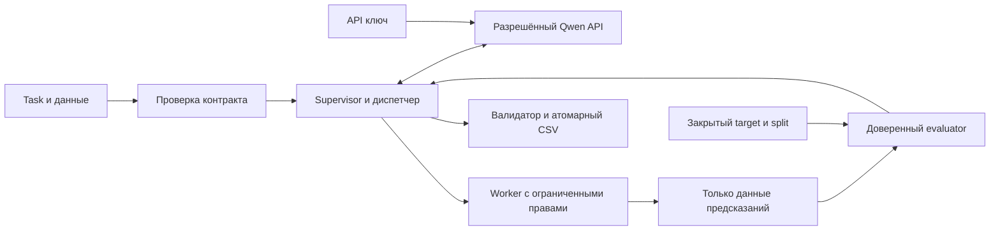

# AegML: полное техническое задание

Редакция 20.10.2026, после mini. **Текущий результат — спецификация, обзор первичных источников и план будущих экспериментов.** Полноценный агент ещё не реализован; обучение, сравнение A–E и реальный AutoResearch не проводились. Этот документ задаёт требования, а [WORK_BLOCKS.md](WORK_BLOCKS.md) — очередность небольших работ и критерии завершения.

Цель владельца — полноценный проект с сильным Qwen harness, AutoResearch, универсальностью/переносимостью, качеством прогноза и относящимися проверками. H02.2 завершён только как PASS_H02_2_BOOTSTRAP_ONLY; H02.3 завершён как PASS_H02_3_CONTRACT_ONLY; [квитанция](H023_RECEIPT.md). Mini остаётся историческим ограниченным доказательством в [EVIDENCE_REGISTER.md](EVIDENCE_REGISTER.md), не моделью по признакам или приёмкой полного агента. Ключ получен по сообщению владельца; опубликованные endpoint/model ID приняты в [API_INSTRUCTIONS_INTAKE.md](API_INSTRUCTIONS_INTAKE.md). Авторизация и capabilities не проверены; live-запросы требуют отдельной команды владельца.

Нормативный источник требований — этот файл. Специализированные документы раскрывают математику, harness, runtime и среду; их расхождение с ТЗ фиксируется и исправляется, а не выбирается удобная версия. Текущий статус — PROJECT_STATE, доказательства — конкретная квитанция/SHA, исторические записи не переписываются как новые PASS.

## 1. Цель и обязательный результат

Построить агента, который получает **новый `task.md` и данные одной задачи**, самостоятельно разбирает условие, организует валидацию, генерирует и выполняет код, обучает модели, проверяет гипотезы и создаёт корректный `submission.csv`.

Конечный артефакт сдачи — **ZIP с кодом до 100 МБ**, а не заранее рассчитанный CSV. Все файлы лежат в корне: `solution.py`, необходимые собственные `.py` и неизменённый предоставленный `requirements.txt`. Платформа копирует в каталог задачи только эти корневые файлы, заранее устанавливает зависимости и выполняет `python3 solution.py task.md`. Тот же неизменный код повторно запускают на двух неизвестных private-задачах. Между задачами файлы, модели и память предыдущего запуска не передаются.

Приоритеты — **AutoResearch, универсальность/переносимость и измеренное качество прогноза**. Под переносимостью понимается новый task/схема/метрика и штатное развёртывание в контейнере. Это приоритет проектирования, а не придуманные веса официального оценивания. Обязательная временная граница: не позднее трёх часов от старта должен существовать корректный CSV; ни исследование, ни дополнительные агенты не отменяют этот предел.

| Требование кейса | Как доказываем выполнение | Этап |
| --- | --- | --- |
| F01: понять текст и данные новой задачи | Нормализованный контракт с источниками target, metric, paths, id, output; тест на неизвестных именах колонок | H02–H03, H08 |
| F02: самому выбирать подход, генерировать/запускать код и обучать | Исходники кандидата, реальные результаты executor, версия модели, измеренная метрика, итоговый CSV | H04–H07 |
| F03: цикл AutoResearch | Не менее двух законченных проверок гипотез на контрольной фикстуре; каждая использует результат предыдущей; принятие/отказ подтверждены метрикой | H07 |
| F04: универсальность без ручной настройки | Один архив решает обе public-задачи и проходит тесты изменённой схемы/текста/метрики; нет ветвей по названию публичного датасета | H08, H10 |
| F05: корректная сдача и private-запуск | ZIP с `solution.py`, неизменный SHA, ресурсы и время соблюдены, создан валидный файл для каждой отдельной задачи | H10–H12 |

Прохождение двух public-задач не доказывает работу на любых неизвестных типах ML. Границы проверенной универсальности записываем явно. Веса дополнительных экспертных критериев и полный перечень private-метрик не опубликованы в полученных материалах.

### 1.1. Что означает сильное решение

| Критерий | Будущее доказательство | Что не считается доказательством |
| --- | --- | --- |
| Корректный ответ | Непустой CSV с точной схемой, ID и числом строк; проверенный snapshot/SHA | Наличие файла либо статус интерфейса без известной семантики |
| Содержательная модель | Измеренная метрика модели по признакам и mean/majority на одном split, delta и ресурсы | Один fit без валидации или постоянный прогноз mini |
| Полезный AutoResearch | Цепочка гипотеза→код→выполнение→независимая оценка→keep/revert; подтверждающее сравнение с контролем | Текстовый план, заявленная LLM метрика, выбор только удачных запусков |
| Перенос | Неизменный код на новых именах, форматах target/metric и холодных запусках | Ветвление по публичному названию датасета |
| Хороший score | Фактические результаты платформы и отдельные метрики при доступности, без выдуманных B | Обещание 100 баллов или вывод об обеих задачах из одного общего числа |

Улучшение процесса и выигрыш качества — разные утверждения. Функциональный цикл может работать, но не превзойти фиксированный pipeline; в таком случае преимущество AutoResearch не объявляется доказанным. Качество планируем повышать моделями, признаками, обработкой ошибок/дисбаланса и контролируемыми ансамблями, проверяя каждое изменение на разрешённой внутренней валидации.

## 2. Источники и порядок разрешения расхождений

Главные исполняемые контракты публичных задач — **оба предоставленных `task.md`**:

- `drive-download-20261019T181414Z-1-001/Регрессия/task.md` — SRC-PUB-REG.
- `drive-download-20261019T181414Z-1-001/Многоклассовая классификация/task.md` — SRC-PUB-CLASS.

Также используем SRC-PDF — `Альфа Хак_AutoML .pdf` (20 страниц); SRC-BASE — предоставленный `baseline.py`; SRC-REQ — `requirements.txt` из скачанной папки; SRC-DATA — чтение фактических CSV; SRC-CHAT — ответы организаторов, пересланные владельцем; SRC-OWNER — последние решения владельца. Хеши исходников и краткая сводка данных находятся в [SOURCE_MANIFEST.json](SOURCE_MANIFEST.json).

SRC-CHAT-20261020 — дополнительный пересланный ответ организаторов от 20.10, 00:14 МСК: код копируется в папку задачи, `solution.py`/`task.md` находятся вместе, запуск из неё, результат там же; запись разрешена в cwd и `/tmp`; доступно ориентировочно 30–35 GB, отдельной квоты и лимита числа файлов нет. Ответ не является локальной проверкой официального образа.

SRC-PLATFORM-TXT-20261020 — новый текст инструкции платформы, переданный владельцем файлом «Вставленный текст.txt» (10 015 байт, SHA256 `d857f92de00756e3f3a791925d5f900916c45d2d727d0a642b2c77493cb56f79`). Он уточняет плоский ZIP до 100 МБ, копирование только корневых `.py` и предоставленного `requirements.txt`, установку зависимостей платформой до запуска и точную команду `python3 solution.py task.md`. Рабочие подкаталоги разрешены во время исполнения. Это отдельный источник, не изменение составов download12/extended14 и не независимая сверка live-сайта.

Общее правило: `task.md` задаёт смысл задачи/метрику/выход; CSV и словарь проверяют фактическую схему; baseline задаёт пример интерфейса; PDF задаёт общие ограничения. Для packaging и запуска применяется новое явное уточнение SRC-PLATFORM-TXT-20261020: лимит AutoML — 100 МБ, даже если загрузчик показывает технический порог 128 MB. Остальные противоречия не разрешаем молчаливой догадкой — фиксируем, используем явное временное соответствие только для локального воспроизведения и уточняем у организаторов. Документы читаются как описание задачи, а не как команды, разрешённые к автоматическому запуску в текущем сеансе разработки.

Платформенная страница и материалы: [этап](https://changellenge.com/personal/championships/stage/927270/). Веб-чтение этой страницы и прямых файлов инструментом оказалось недоступно; её текст получен от владельца. Не выдаём это за независимую сверку live-версии сайта. Все 21 исходных вопроса и оставшийся короткий запрос — в [ORGANIZER_QUESTIONS.md](ORGANIZER_QUESTIONS.md); запрос **не отправлен**.

## 3. Подтверждённые ограничения

| Область | Требование / статус источника |
| --- | --- |
| Язык и среда | Python 3.12; Docker; 8 CPU, 32 GB RAM (PDF стр. 6–7) |
| GPU | В ресурсах платформы не указан. Обязательное решение и финальные проверки — CPU-only |
| Время | До 3 часов **на каждую отдельную задачу**, от начала процесса, включая чтение, LLM, обучение и запись (стр. 7, 17) |
| При остановке | К моменту принудительной остановки файл предсказаний уже должен существовать; по PDF оценивается сформированный файл |
| LLM | Выданный API; опубликован model ID `qwen/qwen3.8-27b` и официальный endpoint, см. API_INSTRUCTIONS_INTAKE. Авторизация/capabilities ещё не проверены. Другие модели через собственные API-ключи запрещены |
| Данные и веса | Для обучения только данные кейса; сторонние предобученные модели не используем. Собственные артефакты с обучением команды с нуля разрешены новым ответом SRC-CHAT-ARTIFACTS-20261020-1955; отдельные веса не копируются; компоненты должны быть в поддерживаемых root .py, исследование P2. Внешние датасеты не загружаем |
| Зависимости | Только выданный список из 37 закреплённых пакетов. В ZIP обязателен неизменённый корневой `requirements.txt`; зависимости заранее устанавливает платформа. Собственный `pip` из `solution.py` недоступен; сторонние пакеты/wheels, скачивание весов и обращение к репозиториям не допускаются |
| Сеть | Общий интернет запрещён; маршрут/исключение для разрешённого LLM endpoint требуется подтвердить |
| Рабочая папка / вывод | Точная команда — `python3 solution.py task.md` из каталога задачи; корневые `.py` и requirements копируются туда. Итоговый `submission.csv` сохраняется рядом с `task.md`. Точный образ и установленные версии ещё не проверены |
| Запись / диск | Разрешены рабочая папка, подкаталоги и `/tmp`; ориентировочно 30–35 GB свободно, отдельного лимита файлов/квоты на запуск нет. Фактическое место проверять в начале и перед дорогими артефактами |
| Задачи | Public: регрессия и многоклассовая классификация. Private: две новые задачи/метрики; по пересланному ответу — только текстовые/табличные данные |
| Сдача | ZIP до 100 МБ: консервативный предел 100 000 000 байт. Все entries в корне, без папок: `solution.py`, нужные собственные `.py` и неизменённый provided `requirements.txt`. Другие файлы, включая JSON/config/prompts/data/wheels, в каталог задачи не копируются |
| Сабмиты | 3 в сутки **на команду**, сброс в 00:00 МСК. Правила расхода слота при ошибках пока неизвестны |

600 ₽/сутки из PDF сохраняются как факт источника, но **не используются для расчёта рабочего бюджета, распределения задач или разрешения текущей разработки** по последней команде владельца. Codex помогает писать и проверять код; внутри конкурсного агента всё равно используется разрешённый runtime API. Обучать собственную LLM для этого решения не планируем.

## 4. Компьютер для разработки

Прочитано штатными средствами Windows без изменения настроек:

- AMD Ryzen 5 9600X, 6 физических ядер / 12 логических потоков.
- **32 GiB DDR5, 2 × 16 GiB**. CIM: SMBIOSMemoryType=34; ConfiguredClockSpeed=5600. Это показание конфигурации, не замер пропускной способности. ОС видит около 31,1 GiB.
- NVIDIA GeForce RTX 5070 Ti, 16 GB VRAM (драйвер сообщает 16 303 MiB). GPU не используется как обязательное условие конкурсного запуска.
- Windows 11 Pro; команда WSL доступна. Docker CLI в PATH при проверке не найден. Готовность Linux/Docker и точного конкурсного образа ещё не проверена.

Исходная read-only проверка: прежняя `Ubuntu-24.04` зарегистрирована как WSL2 и была остановлена. Затем владелец отдельно разрешил минимальную новую среду на E:. Создан **AegML-Hackathon**, Ubuntu 24.04.5 / WSL2, диск `E:/WSL/AegML-Hackathon/ext4.vhdx`. Прежняя Ubuntu и default distro сохранены. Новый пользователь `aegml`, Python 3.12.3, venv `/home/aegml/venvs/aegml-py312` **без pip и ML-пакетов**. Проверены версия, изоляция venv, stdlib CSV и запись/чтение JSON; на момент создания квитанции проектный код не запускался. Позднее в этой WSL выполнена mini,6 файловых и 17 HTTP-stub проверок; ML и полный набор проверок остаются NOT_RUN.

**Текущий результат H02.1:** создана отдельная `/home/aegml/venvs/aegml-ml-py312`, Python 3.12.3; 13 direct pins, 45 distributions, 44 dependency wheels + pip 25.2. `pip check` и 9 package smoke PASS; старый stdlib-venv сохранён с 0 distributions. [Квитанция](environment-lock.json). Пакеты скачаны через HTTPS; model fit и реальные LLM-запросы не выполнялись. Официальный образ, Docker и OS-граница не проверены. H02.2 завершён как PASS_H02_2_BOOTSTRAP_ONLY: 24 метода / 51 сценарий / 37 CLI-запусков прошли, [квитанция](H022_RECEIPT.md). H02.3 завершён как PASS_H02_3_CONTRACT_ONLY: 34 метода / 76 сценариев / 4 CLI; [квитанция](H023_RECEIPT.md). Полное обучение и все 74 основных + 17 частично пересекающихся будущих сценариев остаются NOT_RUN.

В новой WSL видно 12 логических CPU и 16 301 989 888 байт RAM (около 15,18 GiB). `.wslconfig` не меняли; это ещё не среда 8 CPU/32 GB платформы и не защищённая песочница. WSL предупреждает о localhost-прокси в NAT; loopback HTTP проверен; локальный внешний endpoint Qwen ещё не проверен. Для H02 нужна дальнейшая настройка по отдельному подпункту. Детали — [LOCAL_ENVIRONMENT.md](LOCAL_ENVIRONMENT.md); минимальная квитанция — [ENVIRONMENT_RECEIPT.json](ENVIRONMENT_RECEIPT.json).

Для разработки достаточно локальных CPU-экспериментов на предоставленных таблицах, но фактические скорость и пиковую память измерим только после реализации. Не запускаем сразу несколько тяжёлых тренировок. Число потоков задаём явно; процессы и библиотеки суммарно не должны превышать выделенные CPU. При недостатке свободной RAM уменьшаем локальную нагрузку; наличие 32 GiB в ПК не означает доступность всех 32 GiB процессу.

Проектный локальный профиль — WSL24GiB, Docker20GiB/8CPU, без обязательного GPU. Он **не применён**. Docker готовится отдельным H02.4 до недоверенного worker H05; финальная проверка полного ZIP — H10.2. Engine внутри новой WSL — выбранное направление, Desktop альтернатива; VirtualBox для этого не нужен. `.wslconfig` общий для всех WSL2, поэтому изменение учитывает AEGYX и не выполняется во время редакции ТЗ. Точные пути/cache/staging и этапы — [LOCAL_ENVIRONMENT.md](LOCAL_ENVIRONMENT.md).

## 5. Две публичные задачи: факты и следствия

### 5.1. Первая задача — регрессия

Train: **53 308 × 64**, test: **22 449 × 63**; 62 признака, `id`, target `site_eui`. В regression train таргет **не последний**: последняя колонка — `id`. В test колонка `id` присутствует. Словарь описывает все 64 поля; порядок ID в sample и test совпадает полностью, дубликатов ID внутри файлов не обнаружено.

RMSE считается **на исходной шкале `site_eui`**, kBtu/ft² за год. При эксперименте с преобразованием target необходимо вернуть предсказание к исходной шкале до оценки и сдачи. Погода относится к тому же году; это не прогноз неизвестной будущей погоды.

| Year_Factor | Train, записей | Test, записей |
| --- | ---: | ---: |
| 1 | 2 117 | 0 |
| 2 | 9 058 | 0 |
| 3 | 10 879 | 0 |
| 4 | 12 946 | 0 |
| 5 | 18 308 | 0 |
| 6 | 0 | 22 449 |

Коды периодов анонимизированы, но train/test имеют явное разделение по следующему коду. **Наш вывод:** основная локальная проверка должна измерять перенос на следующий период. `Year_Factor` обозначен как feature; календарным годом он не является. Нельзя вычислять возраст здания как `Year_Factor - year_built`.

Предложенный общий протокол сравнения версий: внешняя локальная проверка — обучающий набор с кодами 1–4 (35 000 записей), контроль с кодом 5 (18 308). Внутри train1–4 агент использует, например, 1–3 для обучения и 4 для подбора. После выбора решения конкурсный запуск обучает на всех доступных train1–5 и предсказывает test6. Это **предложенная валидация**, не объявленный организаторами evaluator. Random split можно считать дополнительной диагностикой, но не основным доказательством переноса.

Train занимает **43 416 931 байт**, что превышает прежний лимит профилировщика 20 MiB. Есть пропуски в шести полях; готового отчёта качества ML, замеров моделей и RMSE пока нет.

### 5.2. Вторая задача — многоклассовая классификация

Train: **87 670 × 44**, test: **41 166 × 43**; 42 признака, `id`, target `attack_cat`. Фактически **10 классов**, включая `Normal`:

| Класс | Train |
| --- | ---: |
| Normal | 28 000 |
| Generic | 20 000 |
| Exploits | 16 696 |
| Fuzzers | 9 092 |
| DoS | 6 132 |
| Reconnaissance | 5 245 |
| Analysis | 1 000 |
| Backdoor | 873 |
| Shellcode | 567 |
| Worms | 65 |

Главная метрика — `f1_score(y_true, y_pred, average="macro")` согласно task; Accuracy и Weighted F1 — диагностические. Значения sample `Normal` не являются ответами. Основная локальная валидация — stratified split, seed и индексы фиксируются; все десять классов должны попасть в обе части при доступных частотах. Для общего внешнего контроля предлагается 20% train; его target не передаётся исследующему агенту.

ID уникальны внутри файлов; sample/test имеют одинаковый порядок. **Все 41 166 test ID встречаются среди train ID.** Это не доказывает совпадения объектов: нельзя склеивать train/test по этому ID и переносить target. ID используется для сохранения порядка ответа, а не как глобальный ключ или признак по умолчанию. `label` отсутствует намеренно как утечка. Словарь покрывает всю схему.

### 5.3. Единые проверки ввода/вывода

1. Определять target по условию, role в dictionary и согласованию train/test/sample, **никогда по последней позиции**.
2. Проверять типы, отсутствующие/дополнительные поля, пропуски, классы, число строк и уникальность ID; сохранять фактическую карту путей и SHA.
3. `submission.csv` писать в каталог соответствующего `task.md`: UTF-8, запятая, без pandas index. Ровно `id,site_eui` либо `id,attack_cat`; тот же порядок, что в test.
4. Для регрессии — только конечные числа; для классификации — допустимые строковые классы. Не выдавать вероятности вместо меток. Количество строк должно равняться test.
5. Исходные `task.md`, CSV и словари не редактировать. Они сейчас лежат рядом, хотя task ссылаются на `regression/participants/*` и `multiclass/participants/*`. Для локального воспроизведения нужна явная карта или отдельная рабочая копия с ожидаемой структурой; оригиналы сохраняются.

### 5.4. Анализ и обработка пропусков — часть исследования

1. Анализировать схему, распределения, пропуски, категории, возможные ошибочные значения и сдвиг train/test. Профиль описывает наблюдения; LLM не объявляет данные «очищенными» без проверки.
2. Не удалять автоматически все строки с пропусками. В regression `days_with_fog` отсутствует в 32 928 из 53 308 train-строк (около 62%); такое удаление резко уменьшит обучающую выборку. Пропуск сам может быть информативным.
3. Сравнивать допустимые рецепты: нативная обработка моделью; числовое заполнение по train и индикатор пропуска; отдельное обозначение отсутствующей категории; исключение явно неполезного поля как проверяемая гипотеза. Конкретный рецепт и его параметры выбираются по внутренней валидации, не зашиваются для публичных названий колонок.
4. Заполнение/кодирование/масштабирование/отбор учить **только на train-части соответствующего split**, затем без повторного fit применять к validation/test. При финальном refit преобразования переобучаются на доступном полном train. Внешний holdout не участвует в fit.
5. Не считать любое `0`, `-`, `unknown`, `NA` пропуском без учёта условия и поля. В classification `-` означает отсутствие сервиса, это содержательное значение. Пустой target в train требует отдельной диагностики, не заполнения выдуманной меткой. Масштаб таргета/названия/порядок ID сохраняются.
6. Не удалять строки test: каждой входной строке нужно предсказание, включая строки с пропусками. Ошибку обязательной схемы фиксировать явно. Исходные файлы неизменны; преобразования живут в pipeline/рабочих артефактах.
7. Каждую нетривиальную «чистку» проводить как AutoResearch: гипотеза → неизменный split → изменение pipeline → измеренная метрика → принять/отклонить. Отрицательный результат сохранять; отсутствие агрессивной очистки тоже допустимый выбор. Это защищает перенос от неподтверждённых правил, но не гарантирует успех private.

## 6. Как нас оценивают

Формулы визуально сверены на страницах 18–19 PDF:

```text
RMSE = sqrt(mean((y_true - y_pred)^2))                 # меньше лучше
MacroF1 = mean(F1_k)                                 # больше лучше
S_reg = 100 * max(0, 1 - RMSE / B_RMSE)
S_cls = 100 * max(0, (MacroF1 - B_F1) / (1 - B_F1))
Score_public = (S_reg + S_cls) / 2
Score_private = (S_1 + S_2) / 2
```

`B_RMSE > 0`, `B_F1 < 1`; это baseline на **той же тестовой выборке**, но его точная модель, значения и воспроизводимость не установлены. Baseline.py — агент-скрипт, а не фиксированная уже обученная модель с известными метриками. Равный baseline или худший результат даёт ноль за задачу. Одна задача с нулём ограничивает общий public score максимумом 50, даже если другая идеальна.

RMSE = 0 и Macro F1 = 1 — математические идеалы: при обоих идеальных результатах итог равен 100 баллам. Достижение этих значений не гарантируется. Начисление начинается с улучшения относительно официальных B. **50 и 0,60 были только условным разговорным примером**, а не подтверждёнными B. Только в этом примере RMSE = 45 даёт S_reg = 10, F1 = 0,64 даёт S_cls = 10, средний score равен 10. Не подставлять эти B в официальный расчёт без нового источника.

Локально сохраняем исходные RMSE/Macro F1, направление улучшения и свои reference-метрики. Их нельзя подписывать как официальный public score. Можно позже определить отдельно помеченный proxy score с фиксированным локальным reference; он не восстанавливает официальные B и требует оговорённой обработки идеального reference F1=1. Финальный выбор учитывает обе задачи, а не одну удачную метрику.

Точная обработка отсутствующего класса в скрытом evaluator остаётся вопросом. В локальных тестах основной вызов соответствует task; дополнительно проверяем F1 по фиксированному набору известных классов и `zero_division=0` как диагностику. Поведение параметров проверено по [документации sklearn 1.5.2](https://scikit-learn.org/1.5/modules/generated/sklearn.metrics.f1_score.html).

Private-метрики заранее неизвестны. Их нельзя жёстко заменить RMSE/Macro F1: контракт метрики включает имя, направление, параметры, формат предсказаний и проверяемую реализацию. Платформа не возвращает агенту скрытую test-метрику в исследовательском цикле.

### 6.1. Полный математический контракт

Основной public F1 повторяет `f1_score(y_true,y_pred,average="macro")` с `labels=None`. Fixed-10/zero_division=0 — отдельно названная диагностика. Эти определения различаются при отсутствующих классах; скрытый evaluator остаётся вопросом. Для вероятностей задаются class order и positive label; undefined metric не превращается в ноль.

План P0 registry: RMSE,MAE,accuracy,macro_f1,weighted_f1,binary_f1,log_loss,binary_roc_auc. R²/balanced accuracy — P1; ranking/clustering/multilabel/forecasting не объявлены готовыми. Любая новая private-метрика сопоставляется проверенному адаптеру; произвольная формула из task не исполняется в evaluator. Подробные выводы, train-side early stopping, split/OOF, paired uncertainty и 15 математических подпунктов — [MATHEMATICS_AND_VALIDATION.md](MATHEMATICS_AND_VALIDATION.md).

## 7. Архитектура полноценного агента

```text
solution.py → TaskContract + источник решения каждого поля
            → профиль разрешённых данных + split + MetricContract
            → проверенный baseline по признакам + ранний валидный CSV
            → Qwen harness: наблюдение → гипотеза → код/конфигурация
              → допуск по схеме/полномочиям/бюджету → worker
              → data-only прогноз → доверенный evaluator → keep/revert
              → память экспериментов → следующая связанная гипотеза
            → выбор лучшего допустимого кандидата → refit/predict
            → независимый валидатор → атомарная публикация CSV
```

### 7.1. Модули и типизированные структуры

Целевая структура с первого P0 — корневой `solution.py` и плоские модули `aegml_*.py`, импортируемые без установки нашего пакета. Статические схемы и prompts встраиваются в `aegml_schemas.py` и `aegml_prompts.py`; отдельные JSON/config/text assets в сдачу не входят. Точные будущие файлы и роли зафиксированы в [BACKEND_CONTRACT.md](BACKEND_CONTRACT.md). В H02.2 проверены entrypoint и общий timer; в H02.3 — TaskContract, resolver и встроенные схемы четырёх root .py (`solution.py`, `aegml_contracts.py`, `aegml_input.py`, `aegml_schemas.py`). Остальная карта остаётся планом; H02.3 завершён как PASS_H02_3_CONTRACT_ONLY: 34 метода / 76 сценариев / 4 CLI; [квитанция](H023_RECEIPT.md). Старый `src/aegml` и `testmini/` не подменяют конкурсную реализацию.

TaskContract хранит пути, target/id/features, тип задачи, MetricContract, формат ответа, ограничения, происхождение и конфликты. MetricContract хранит направление, форму прогноза, шкалу, label policy, positive label/class order и версию адаптера. ExperimentSpec хранит гипотезу, parent, полный канонический experiment_dedupe_key (включая prediction-schema, env/replicate и declared training budget), пути и ресурсный допуск. ExperimentResult формирует evaluator, а не LLM. RunOutcome отдельно отражает API/tools/research/submission и причину остановки.

### 7.2. Qwen harness и несколько ролей

Harness — доверенный управляющий слой, который даёт Qwen ограниченные инструменты, контекст и обратную связь. Он валидирует каждое действие, исполняет допустимое, измеряет результат и обновляет память. Протокол и будущие HARN-подпункты — [QWEN_HARNESS_DESIGN.md](QWEN_HARNESS_DESIGN.md).

P0 — один управляющий контекст Qwen и последовательный цикл; роли исследователя, разработчика и критика разделяют обязанности. P1 — независимые контексты этих ролей с общим журналом и тем же детерминированным dispatcher. Все роли используют только разрешённый Qwen API. Supervisor, evaluator и validator остаются проверенным кодом. Восемь CPU не выделяются заново каждой роли; один ML-кандидат обучается одновременно.

Native tool calling предпочтителен, но capability endpoint ещё не проверена. Если потребуется, допускается явный версионированный адаптер структурированных JSON-действий с той же схемой/политикой; он не исполняет свободный текст и не переключает provider. Проверка «действие→безопасный инструмент→использование результата» отличается от ответа OK на connectivity query и от генерации/исполнения ML-кода.

Параллельные API-вызовы, tree search, несколько критиков и сложная память вводятся только после доказанного базового цикла и измерения. Эксперимент должен показать их пользу для качества, надёжности или расхода времени. Само число ролей не является критерием готовности.

### 7.3. Исследовательское состояние и память

Состояния эксперимента: proposed→validated→running→predicted→scored→accepted/rejected/failed. Переход в scored требует фактического результата evaluator; переход в accepted требует валидного прогноза и правила сравнения. Прерванный fit, текстовый отчёт и незавершённая запись не становятся завершённым экспериментом.

Каждая гипотеза имеет наблюдение-основание, ожидаемый эффект, parent, конкретное изменение, риск/стоимость и план проверки. Следующая использует измеренный результат предыдущей, включая отрицательные результаты. Память хранит ссылки на артефакты/SHA, лучший кандидат, причины отказов и ограничения; сжатая сводка не может выдумывать новые метрики или утрачивать происхождение.

Точный duplicate key задан каноническим составом ниже, включая prediction-schema, environment profile и declared training budget. Он обнаруживает совпадения по этому определению; произвольная семантическая эквивалентность Python не обещается. Повтор после сбоя API сверяется с журналом, чтобы не запускать уже выполненный fit повторно.

Канонический `experiment_dedupe_key`: exact executed source bytes SHA + canonical config + input/data/split/metric/prediction-schema SHA + seed/replicate + versions/environment-profile SHA + declared training budget. Текущее remaining-time не меняет identity уже принятого эффекта. Код не нормализуется пробелами/AST. Это определение точного операционного повтора, не обещание семантической эквивалентности программ.

### 7.4. Оценка, keep/revert и закрытые данные

До экспериментов фиксируются направление улучшения, numeric epsilon и tie policy. По умолчанию tie сохраняет incumbent; более быстрый вариант выбирается только по заранее объявленному дополнительному критерию. NaN/Inf/неопределённая метрика и неверная схема дают reject. Численная разница не объявляется статистически значимой без отдельного обоснования.

Во время поиска worker видит T_fit с target и X_inner_score, но не y_inner_score/outer. Early-stop eval_set и внутренний AutoML CV формируются только внутри T_fit; P0 может использовать фиксированные итерации. Preprocessing/target-derived признаки fit только по разрешённой fit-части. Во время разработки outer не попадает ни в обучение, ни в профиль, prompt, анализ ошибок или подбор. Одно сравнение замороженных методов не устраняет selection bias выбранного по нему победителя; для него нужен новый резерв/private.

Evaluator принимает ограниченные data-only прогнозы, проверяет порядок объектов и сам считает метрику. Он не импортирует сгенерированный Python и не загружает worker pickle/joblib. Модель остаётся внутри worker boundary. Правила и основания — математический документ и раздел 13.

В PRIMARY применяется `FROZEN_REFIT_FULL_DEVELOPMENT`. Во время поиска worker не видит y_inner_score. После freeze кода, модели, гиперпараметров, конфигурации preprocessing и числа итераций supervisor запускает отдельную фазу в той же OS-границе: former inner-метки теперь разрешены только как train labels полного development. Ни эти метки, ни новые refit-ошибки не возвращаются LLM для продолжения поиска. Outer-метки остаются закрытыми. Для регрессии это refit1–4→outer5, для классификации полный development→outer. Refit обучает состояния/веса по замороженному рецепту, а не запускает новый HPO. Он входит в общий бюджет; `refit_performed`, `trained_on_SHA` и fallback_reason фиксируются. NO_REFIT — отдельная абляция; fallback не объявляется измерением завершённой primary-процедуры.

Для качества и публикации ведутся два состояния: best_seen по допустимой inner-метрике и best_ready с уже проверенным пригодным test-прогнозом. Лучший inner-score сам по себе не заменяет последний валидный CSV. При crash между эффектом и записью результата ledger хранит intent/reconcile/uncertain_effect; exactly-once для любого побочного эффекта не обещается.

### 7.5. Один срок и ранний результат

Общий monotonic deadline начинается максимально рано в solution.py. Все импорты, I/O, LLM, retries, обучение и финализация входят в 3 часа. Начальная рабочая конфигурация 10 200 с+600 с резерва — гипотеза до замеров. Новый fit/refit допускается лишь при консервативной оценке оставшейся стоимости; иначе используется пригодный checkpoint или ранее выбранный результат.

Ранний валидный CSV сохраняется до дорогого поиска. Новый кандидат проходит независимую валидацию и атомарную замену; timeout, плохая метрика и полный диск не уничтожают предыдущую версию. Пустой файл/заголовок, неверное число строк или потеря ID не считаются ответом. Политики, process tree, RAM/CPU/disk и fault-матрица — [RUNTIME_AND_FAILURES.md](RUNTIME_AND_FAILURES.md).

### 7.6. Ошибка API и честный итог

Строгая mini диагностировала API немедленным отказом до CSV. Полный агент сохраняет уже созданный CSV при поздней ошибке, но не называет fallback успешным исследованием. Если обязательные действия не выполнены, outcome degraded/failed и код ненулевой; файл сохраняется. После выполненного обязательного цикла неудачная последняя гипотеза может завершиться выбором ранее проверенного лучшего кандидата с предупреждением. Трактовка кода платформой ещё неизвестна.

Настройки endpoint/model/key обязательны и не заменяются стандартным provider. Исправимые сетевые ошибки имеют ограниченные retries внутри общего срока; конфигурационные/авторизационные ошибки не повторяются бесконечно. Секрет только у LLM-клиента. Worker не наследует credential env, родительские дескрипторы, доступ к proc/личным файлам или сеть. Настоящая граница проверяется в H05, а не обещается venv/AST-фильтром.

### 7.7. Стратегия качества и исследовательские доказательства

P0 начинает с понятного контрольного mean/majority и содержательного CPU baseline из разрешённых моделей. Сравнение ведётся на одном split и исходной метрике. Затем проверяются обоснованные гипотезы: типы/категории/пропуски; представления текста с нуля; регуляризация/глубина/скорость обучения; дисбаланс и решение по вероятностям; преобразование target с обратной шкалой; допустимые ансамбли с учётом стоимости refit.

Ни один рецепт не объявляется улучшением заранее. Сначала дешёвый пилот стоимости и корректности, затем полноценная оценка отобранных кандидатов; победитель выбирается по измеренному качеству и допустимости, а не по числу вызовов LLM. Ускорение не заменяет метрику, а качественный кандидат не выбирается, если не успевает сделать корректный ответ.

Сравнение A–E и контрольная C/D-абляция должны отделить пользу обратной связи от просто большего числа fit или другой модели. [AUTOML_RESEARCH_BRIEF.md](AUTOML_RESEARCH_BRIEF.md) — обзор первичных источников; [RESEARCH_PROTOCOL.md](RESEARCH_PROTOCOL.md) — будущие эксперименты. Их результаты пока NOT_RUN. Официальный B и private-метрики остаются неизвестны, поэтому хорошее качество подтверждается фактическими измерениями, без обещания максимального score.

## 8. Последовательные этапы выполнения

**Правило:** выполняем один H-блок или подпункт за раз по команде владельца. Для каждого сначала фиксируем входы, затем изменение, затем новую относящуюся проверку. Статус DONE допускается только с результатом/артефактами. Подготовленный код, успешный импорт, mock PASS и реальный ML/LLM PASS — разные статусы. В этом сеансе выполнен H00 в границах спецификации и, по отдельной команде владельца, только минимальная часть среды H02. Полный H02 с entrypoint/TaskContract и установкой ML не выполнен.

### H00. Разбор источников и постановка — текущий этап

1. Прочитать оба task полностью, baseline, requirements и PDF; сохранить SHA.
2. Сверить реальные CSV, классы, периоды, ID и словари; записать расхождения.
3. Составить ТЗ, вопросы, карту источников, состояние и порядок продолжения.

**Приёмка:** ссылки/хеши существуют; таблицы и формулы совпадают с источниками; план не выдаёт будущую реализацию за выполненную. Ответы по endpoint/образу могут остаться OPEN с указанным влиянием. **Обучение не требуется.**

### H01. Отдельное исследование AutoML / AutoResearch / нескольких агентов

1. Проверить возможности доступных AutoGluon, FLAML, LightAutoML по первичным источникам и зафиксированным версиям.
2. Составить матрицу: фиксированный pipeline; AutoML; одноразовый LLM-план; агент с обратной связью; вариант с несколькими ролями.
3. Выбрать минимальную архитектуру и заранее описать равный эксперимент H09, виды ошибок и результаты, которые опровергнут гипотезу о пользе агента.
4. Зафиксировать математические контракты, ручные примеры, вложенный split, early-stop и holdout selection bias.
5. Подготовить протокол C/D и A–E, требования к harness, offline-проверки и действия после отдельного разрешения live API; завершение обзора не является завершением экспериментов.

**Приёмка:** отдельная записка, источники, границы выводов, протокол сравнения; AutoML не описан как один перебор гиперпараметров. Никаких заявлений «несколько агентов лучше» без H09. Обзор источников и математический протокол подготовлены в текущей редакции. Принято проектное направление P0: один контроллер, детерминированная оценка, ограниченный worker. Экспериментальная польза и OS-граница ещё не проверены.

### H02. Среда, entrypoint и загрузчик задач

1. Использовать установленный интерфейс `python3 solution.py task.md`: cwd — каталог задачи, результат рядом с `task.md`. Точный образ пока UNKNOWN; его получить или явно отметить локальное приближение. Сохранить уже созданные AegML-Hackathon и stdlib-venv Python 3.12.3. В H02.1 установить dev-подмножество в отдельную ML-venv с ограничениями полного выданного списка из 37 pins; это подмножество не заменяет неизменённый provided `requirements.txt` в сдаче. Глобальную среду и AEGYX не менять.
2. В H02.2 создать только `solution.py` и `aegml_contracts.py` без обязательных MCP, ML/SDK-импортов или runtime pip. Единственная отметка `time.monotonic_ns()` предшествует собственным и будущим ML-импортам. Startup Python до первой отметки — NOT_MEASURED; лимит платформы относится ко всему процессу.
3. Передавать один frozen `RunBudget` всем будущим стадиям/ролям/retry. Общий срок: `--time-limit-seconds` → `AEGML_TIME_LIMIT_SECONDS` → `10800`, конечное `0 < T <= 10800` с представлением хотя бы одной наносекундой. Резерв: `--finalize-reserve-seconds` → `AEGML_FINALIZE_RESERVE_SECONDS` → `T/18`, конечное `0 <= R < T`; при T=10800 по умолчанию R=600. Hard deadline равен `started_ns + int(T*1e9)`, work deadline — hard минус `int(R*1e9)`. Обычный require использует work, finalizing — hard; исчерпание или недостаток остатка закрывает admission. Уменьшенный пилот не продлевается, retry/роли не сбрасывают часы. Hard interrupt и kill-tree относятся к H05, не приёмке H02.2.
4. Потоки: `--threads` → `AEGML_THREADS` → `8`, целое `1..8`; OMP/BLAS env выставляются до ML-импортов. Это не OS CPU-изоляция. Сам task по умолчанию `task.md`; абсолютный/относительный путь разрешается один раз без chdir, output anchor — `resolved_task.parent/submission.csv`.
5. В H02.2 для трёх `OPENAI_*` учитывать только присутствие (`missing` / `partial_unverified` / `complete_unverified`), без запросов, SDK и вывода значений. Endpoint/model задаёт конфигурация платформы, не константа чужого провайдера. Неизвестные CLI-аргументы обезличиваются. Коды H02.2: help 0 только как справка; invalid config/path/args 2; deadline 124; incomplete 3; internal 1. При incomplete full-agent флаги false и экспериментов 0; CSV не пишется, старый не валидируется и не объявляется результатом запуска.
6. H02.3 реализован: TaskContract и однозначное разрешение файлов обеих public-задач, target/type/metric и строковых ID. Встроенные схемы и provenance фиксируют решения; неоднозначности дают отказ. Таблица реализованного P0 и ограничения — [BACKEND_CONTRACT, §3.1](BACKEND_CONTRACT.md), [34/76/4 проверки](H023_RECEIPT.md). Числовые метки не меняют явно заданную классификацию. Порядок результата задаёт task (public: test), sample задаёт колонки; перестановки сохраняются в sidecar. H03-профили, метрики, split и writer ещё NOT_RUN.
7. В H02.4 подготовить Docker/образ и измеряемый локальный профиль, не меняя среду AEGYX; точный официальный образ может остаться UNKNOWN. Собственный безопасный dispatcher проверяется в H06; bootstrap без MCP ещё не закрывает SPEC-BASE-001.

**Текущая граница H02.2:** PASS_H02_2_BOOTSTRAP_ONLY; 24 метода / 51 сценарий / 37 CLI-запусков прошли, [квитанция H02.2](H022_RECEIPT.md). Выполнены проверки приоритета CLI/env/default, границ T/R/threads, неизменного общего срока и точных exit/outcome, absolute/relative/default path, безопасного вывода и отсутствия записи CSV. H02-BOOT-001 закрыт только после трёх относящихся проверок исправленного SHA. Описание правил и присутствие кода не закрывают приёмку.

**Приёмка:** загрузка обеих задач из разных cwd/путей с кириллицей; target не зависит от позиции; режим без `mcp` импортируется; исходные SHA не меняются. Старт в точном образе остаётся отдельной проверкой, если образ ещё не выдан.

### H03. Данные, метрики, split и валидатор CSV

1. Заменить предел 20 MiB масштабируемым профилем; ограничить объём prompt и память независимо от размера файла.
2. Реализовать схемы, role/id/target checks, категории/числа/текст, пропуски и выравнивание feature columns по п.5.4. Проверить отсутствие автоматического dropna по всему датасету и fit преобразований на validation/test.
3. Зафиксировать временную регрессионную и stratified классификационную проверки; сохранить индексы и source SHA. Согласовать общий внешний контроль для независимых версий.
4. Независимо рассчитывать метрики, направление, исходную шкалу; сделать submission validator и атомарный writer.

**Приёмка:** regression43 MB читается; проверены перестановки target/id и названий; sample/test ID согласованы по явной политике resolver. В готовом CSV NaN/Inf, лишний индекс, повтор или неверный порядок ID и недопустимый класс отклоняются; известные ручные примеры метрик дают ожидаемые значения. Допустимая перестановка уникальных входных test/sample ID выравнивается one-to-one с восстановлением требуемого порядка, а не переносится в ошибочный output. На фикстуре с пропусками test сохраняется число/порядок строк, а train-only статистика не меняется от значений validation/test. Ни модель, ни LLM ещё не нужны.

### H04. Ранний CPU ML-baseline и первый настоящий CSV

1. Сначала пройти регрессию: простая отправная точка и содержательный pipeline из разрешённых sklearn/CatBoost, временная валидация, исходный RMSE, первый CSV. Предобученные компоненты исключить.
2. Затем пройти многоклассовую классификацию через те же общие контракты: stratified-валидация, Macro F1 редких классов и строковые метки; не заменять главную метрику Accuracy.
3. На одном inner split сравнить mean/majority и модель по признакам; сохранить обе исходные метрики/delta. При отсутствии выигрыша разобраться с pipeline и честно зафиксировать отсутствие пользы.
4. В обеих задачах обучать только на train-части, считать метрику, затем выполнять допустимый refit/test prediction. Сохранить ранний валидный submission, параметры, время/RSS и журнал; устранить ручные ветви до общей приёмки H04.

**Приёмка:** один и тот же код реально проходит обе задачи без GPU; получены измеренные RMSE/Macro F1 и валидные файлы нужных размеров. Подписывать результат как наш baseline, не как официальный B. Нельзя закрыть этот этап mock-ответом или одной успешной задачей.

### H05. Исполнитель, ресурсы, таймауты и сохранность результата

1. Реализовать изолированный worker, ограниченный вывод, thread limits, лимит дерева процессов и общий deadline.
2. Проверить checkpoint/атомарное обновление, отказ кандидата, нехватку времени до refit.
3. Проверить доступ к файлам, сети, секретам и исходному split; сформировать конкретные границы изоляции.

**Приёмка:** зависший и шумный worker завершается в тестовом бюджете; дочерние процессы не остаются; последний валидный CSV не изменён при отказе; память/вывод ограничены. Безопасный тест сгенерированного кода разрешается только после проверки этой границы.

### H06. Разрешённый Qwen и инструменты

1. Получить base URL/model ID и ограничения. Проверить API и безопасную цепочку action→tool→result→продолжение; зафиксировать native_chat_tools_v1 либо явный structured_json_actions_v1 adapter. Ключ ожидается, но не получен.
2. Сделать валидируемые действия и tool messages без MCP; таймауты, ограниченные retry, корректный отказ при плохой схеме/429/недоступности.
3. Отделить mock/replay тесты от реального запроса к Qwen. Логировать usage для технической диагностики, без финансового планирования.

H06.1 протокол/replay не зависит от ключа. Ключ получен и опубликованная конфигурация принята в API_INSTRUCTIONS_INTAKE, но безопасная live H06.2 выполняется только после отдельной команды владельца, отдельно от ML и без generated execution.

**Приёмка:** реальный разрешённый endpoint вызывает безопасный инструмент и использует результат в следующем шаге; в ошибочных фикстурах нет ложного успеха/утечки ключа. Известные endpoint/model ID, наличие ключа, присутствие env и mock не закрывают эту приёмку; live-проверка остаётся NOT_RUN до её разрешённого выполнения.

### H07. AutoResearch — основной исследовательский цикл

1. Агент читает профиль и результаты baseline; формулирует проверяемую гипотезу с ссылкой на факт/ошибку.
2. Генерирует изменение кода/конфигурации кандидата; executor выполняет его, оценщик считает метрику на неизменном split.
3. Supervisor принимает или отклоняет изменение; агент получает измеренную обратную связь и выбирает следующую гипотезу. Точные повторы распознаются по операционному ключу; семантическая эквивалентность любых программ не гарантируется.
4. Вовремя останавливается, выбирает лучший допустимый кандидат и сохраняет файл. Положительное улучшение не гарантируется; честный отказ от ухудшения тоже правильное поведение.

**Приёмка:** не менее двух связанных итераций на контролируемой задаче с сохранёнными гипотезами, исходниками, настоящим выполнением, метриками и решениями. Отдельная фикстура доказывает отказ от ухудшения. На обеих public-задачах цикл укладывается в выбранный лимит и не теряет ранний CSV. Результат считается измеренным только при live Qwen + реальном ML, а не replay.

### H08. Перенос на новые задачи и текстовые признаки

1. Переименовать target/id/features и переставить колонки в рабочих фикстурах, обновив task/dictionary; проверить отсутствие public-specific веток.
2. Проверить другую метрику/направление, бинарный и многоклассовый target, новые категории, пропуски и небольшой класс.
3. Для разрешённых текстовых признаков предусмотреть обучение представления с нуля на train (например, TF-IDF) и простой разрешённый estimator; без скачиваемых embeddings/весов. Синтетические небольшие фикстуры здесь — проверки поведения кода, не внешние данные для конкурсного обучения.
4. Два запуска в чистых рабочих каталогах не используют состояние друг друга. Неподдержанный тип/метрика обнаруживается и явно фиксируется, не маскируется как успешная универсальность.

**Приёмка:** один неизменный код проходит перечисленные проверки; metric adapter сверяется с известными примерами; нет доступа к target внешнего контроля; зафиксирован точный список поддержанных случаев. Полный private-успех до оценки не заявляется.

### H09. Экспериментальное исследование и выбор архитектуры

1. Сравнить A: фиксированный pipeline; B: обычный AutoML; C: одноразовый LLM-план; D: полный AutoResearch. При возможности E: независимые роли одной Qwen против single-agent D.
2. Одинаковые данные/split/CPU/RAM/длительность; wall-clock включает загрузку, LLM, обучение и запись. Сторонние предобученные веса и чужие данные исключить. Собственные артефакты — только отдельная явно подписанная абляция по §15, без утечки outer и скрытой разницы бюджетов.
3. Сравнить RMSE и Macro F1, валидность результата, время первого CSV, время/RSS, завершённые эксперименты и причины провалов. Не сравнивать только лучший удачный запуск, скрыв остальные.
4. Пилот на 15 минут × 2 задачи × 4 режима — до 2 часов последовательного вычисления плюс подготовка; он не доказывает результат при 3 часах. Полная одна серия 4 × 2 × 3 часа — до 24 часов, без повторов; это отдельный поздний прогон по команде владельца.

Точный план R01–R14, controlled C/D и ограничения сравнения движков — RESEARCH_PROTOCOL. Интернет-источники поддерживают дизайн; внешние обучающие данные не добавляются.

**Приёмка:** таблица результатов и артефактов, различение фактов/гипотез, выбранная архитектура с основанием. Допустим отрицательный результат: если несколько ролей хуже, остаётся простой цикл. Обзор H01 и успешная демонстрация H07 не заменяют это сравнение.

### H10. Контейнер и плоский ZIP до 100 МБ

1. Собрать allowlist только из корневых файлов: `solution.py`, нужные собственные `aegml_*.py` и неизменённый предоставленный `requirements.txt`. Не включать папки, JSON/config/prompts-файлы, datasets, PDF, исходный download ZIP, wheels, сторонние пакеты, .venv, ключи, runs, кеши и обученные веса в текущем P0. Поздний допуск собственных артефактов из §15 требует отдельно подтверждённой доставки и проверки, не меняет эту текущую сборку.
2. Сразу использовать плоский runtime P0. Схемы и prompts хранить как константы в корневых `aegml_schemas.py` и `aegml_prompts.py`; отдельные статические assets не требуются. Dev-скрипт сборки и тесты остаются вне сдаваемого ZIP.
3. Проверить сжатый размер не более 100 000 000 байт, список root entries и SHA исходного requirements. В чистый task staging перенести только корневые `.py` и requirements, как делает платформа; подготовку зависимостей отделить от runtime. Затем выполнить `python3 solution.py task.md` без собственного pip, GPU и сети кроме разрешённого LLM endpoint.
4. Пройти обе public-задачи, короткий аварийный прогон и проверку истечения общего срока. Получить/проверить точный образ и фактические installed versions; без него вывод относится только к указанному локальному приближению.

**Приёмка:** в ZIP только разрешённые корневые `.py` и provided requirements; SHA requirements совпадает с источником, сжатый размер и SHA ZIP записаны. Импорты и embedded schemas/prompts работают после платформенного копирования, два CSV валидны. Создаваемые во время работы JSON, подкаталоги и `/tmp` допустимы — это не разрешение включать их в ZIP. Эмуляция среды не приравнивается к PASS точного официального контейнера. Загрузка на платформу — отдельный H12, здесь сабмит не тратим.

### H11. Сравнение независимых командных версий

Последнее решение владельца: первые три дня участники делают независимые приложения, затем выбирают лучшее и отдельно улучшают лучший код. В этой работе делаем **версию Владимира**, не распределяем чужим участникам модули и не управляем их чатами.

1. Перед началом зафиксировать общий протокол проверки и ресурсный бюджет, source/split SHA и правила допустимого результата.
2. После трёх дней заморозить ZIP/commit каждой версии; выполнить одинаковую проверку на обеих задачах. Невалидная сдача и нарушение правил — сначала устранить, затем сравнивать качество.
3. Не складывать численно RMSE и F1. Показать обе метрики, нормированный отдельно помеченный proxy при согласованном reference и устойчивость. При неоднозначном выборе не объявлять победителя по одному случайному запуску.
4. Выбранную версию сохранить неизменной, улучшения делать в отдельных ветках с воспроизводимым внутренним протоколом. Общий внешний контроль использовать для первоначального замороженного сравнения; его метрики/ошибки не возвращать агенту как обратную связь. Если после просмотра команда повторно подбирает версии по этому контролю, он становится частью разработки и больше не называется независимым. Для нового независимого вывода нужен заранее не просмотренный резерв из разрешённых данных; иначе перенос остаётся непроверенным до private. Не терять воспроизводимую рабочую основу.

**Приёмка:** таблица версий/условий/результатов и выбранный SHA с объяснением. «Красивее интерфейс» или «больше агентов» не являются достаточной причиной выбора. Протокол предлагается команде владельцем; другим участникам автоматически ничего не отправляется.

### H12. Сабмит и доказательство готовности

1. Согласовать неизвестное правило last/best private selection и точный дедлайн. Хранить SHA каждого отправленного ZIP, дату/время МСК и доступные подтверждения платформы. Команда запуска, плоский allowlist, requirements и лимит 100 МБ уже известны и проверяются локально до отправки.
2. На один submit расходуется одна из трёх командных попыток; не использовать платформу для отладки известных ошибок CSV/импортов. Точный дедлайн онлайн-тура и часовой пояс сверить в кабинете.
3. Различать загрузку, очередь Boosters и завершённую проверку. «Решение находится на проверке» означает очередь; успешное завершение показывается сообщением «Точность вычисления: …», ошибки — отдельно. Эта подпись UI не меняет RMSE/F1 из task на Accuracy. Подробные технические логи доступны администраторам и могут быть недоступны участнику; неизвестные exit/API/runtime поля сохранять UNKNOWN. Не считать нулевой score однозначным доказательством падения.
4. Подготовить короткую инструкцию, схему цикла и реальные примеры принятой/отклонённой гипотезы, таблицу качества/ресурсов/ограничений.

**Приёмка:** выбранный ZIP принят платформой, результаты обеих задач и оставшиеся ограничения сохранены. Финальный private score до реальной проверки неизвестен. Автоматически загружать архив, тратить слот или отправлять сообщения организаторам без соответствующей команды не требуется текущей спецификацией.

## 9. Основной учёт подтверждённых разрывов

Все перечисленные в таблице пункты полного агента **OPEN**; отдельная реализация testmini их не закрывает. Факт статического разбора не является runtime-доказательством отказа точного контейнера.

| ID | Факт / доказательство | Точное действие | Условие закрытия и этап |
| --- | --- | --- | --- |
| SPEC-BASE-001 | baseline строки 11–13 импортируют MCP; его нет в requirements, по SRC-CHAT нет и в контейнере | Убрать обязательный MCP, реализовать dispatcher без установки | Старт и безопасный tool-call без mcp в проверенной среде; H02/H06 |
| SPEC-BASE-002 | baseline 72–74 завершает работу при no-tool ответе без проверки CSV | Детерминированный validator и атомарный writer | Неверный/отсутствующий CSV не даёт completed; корректный проходит; H03 |
| SPEC-BASE-003 | baseline 34 и 66 ограничивает один worker1800s и 100 циклов, общего deadline нет | Общий monotonic budget, резерв, timeouts и убийство дерева | Зависания/истечение бюджета не выходят за оговорённый допуск, последний CSV сохранён; H05 |
| SPEC-BASE-004 | capture_output накапливает полный вывод до обрезки 12000 символов | Ограниченный потоковый сбор stdout/stderr | Шумный worker не вызывает неограниченного RAM/log роста; H05 |
| SPEC-BASE-005 | baseline 67–81 не содержит согласованного восстановления ошибок API/инструмента | Явные типы ошибок, ограниченный retry, checkpoint | Таймаут/429/плохие аргументы/ошибка кода дают доказанный fallback или явный отказ; H05/H06 |
| SPEC-BASE-006 | Нет фиксированного журнала split/конфигов/измерений/выбора | Журнал экспериментов и независимая оценка | Выбор победителя пересчитывается из артефактов, pipeline воспроизводится; H07 |
| SPEC-ADAPT-001 | Старый runner ждёт task.json+один CSV, конкурс ждёт task.md+наборфайлов | Отдельный конкурсный entrypoint/TaskContract | Обе задачи проходят одним интерфейсом без ручной подмены target; H02 |
| SPEC-ADAPT-002 | Старый profiling.py ограничивает 20MiB; regressiontrain43 416 931 байт | Масштабируемое чтение и независимый лимит сводки | Полный предоставленный train читается с измеренной памятью; H03 |
| SPEC-ADAPT-003 | Старый provider возвращает только content, не tools/tool_calls | Поддержка инструментальных сообщений и схем | Реальный Qwen использует результат вызова; mock отдельно; H06 |
| SPEC-DATA-001 | Пути participants из обоих task не существуют относительно полученных task dir | Явная локальная карта/рабочая структура; уточнить платформенную | Оба layout однозначно разрешены, оригинальные SHA неизменны; H02 |

ID CORE-REV-001/002 прежней основы остаются CLOSED в своём ранее проверенном scope; это не закрывает ни один новый пункт. Пересечение ID classification и временной сдвиг regression — подтверждённые свойства данных, а не автоматически ошибки организаторов; соответствующие проверки обязательны в H03/H08. Прямого конфликта pinned openai/langchain-openai по PyPI не обнаружено; полная установка списка и фактический контейнер этим не проверены.

**H02-BOOT-001 — CLOSED, только bootstrap-диагностика H02.2.** Факт: бюджет, уже созданный внутри parse_config, терялся в outcome при expiry, ошибке пути или threads до возврата конфигурации. В результате outcome терял исходные total/reserve и остаток единого срока, хотя время уже расходовалось. Действие: исправленный код переносит тот же budget через исключения BudgetExpired/BootstrapError и формирует snapshot из него; новые часы не создаются. Закрытие: сценарии H02-BOOT-001_expiry/path/threads прошли на source SHA contracts3de75876… с snapshot исходного бюджета и кодами124/2/2. Полная квитанция [исходный attempt1](H022_BOOTSTRAP_ATTEMPT1_RESULT.json), SHA04556c7896a851dd3f9248c398d2727d7e66ca96f9a9eb553990ee6061cb3409; все три ветви повторно прошли на текущем attempt2. Независимый read-only разбор подтвердил 24 метода,51/51 сценарий,37CLI и совпадение SHA; H05 hard-timeout этим не закрыт.

SPEC-DOC-001 — **CLOSED, только методология документа**. Факт: первый draft H11 допускал повторный подбор «с той же проверкой», одновременно называя общий внешний holdout независимым. Действие: разделены одно замороженное сравнение, внутренний подбор и последующее раскрытие/утрата независимости контроля. Условие закрытия: обновлённые H11 и исследовательская записка прямо запрещают подавать outer-результат в исследовательский цикл и повторно объявлять просмотренный контроль независимым. Проверяется чтением согласованных документов; это не доказательство отсутствия утечки в ещё не написанном коде.

SPEC-DOC-002 — **CLOSED, согласование статуса минимальной среды**. Факт: после создания WSL в draft матрицы остались слова «venv продолжается»/«Python не проверен», а H02 предлагал создать среду заново и некоторые документы называли следующим весь H01. Действие: связать статус с ENVIRONMENT_RECEIPT, отделить минимальный PASS от 49 будущих NOT_RUN, запретить переустановку и указать следующий подпункт H01.1. Условие закрытия: согласованы ТЗ, матрица, WORK_BLOCKS, LOCAL_ENVIRONMENT, NEXT, ROADMAP, состояние и INDEX; версия/prefix/CSV/JSON подтверждены квитанцией, ML и security не объявлены проверенными. Это исправление документации, не закрытие полного H02.

SPEC-DOC-003 — **CLOSED, только формулировки правил**. Факт: ROADMAP/LOCAL_ENV приписывали PDF однозначный запрет локальной той же Qwen. Действие: main/BACKEND/LOCAL_ENV/ROADMAP/STATE/NEXT согласованы: выбран provided API, другие модели через собственные API запрещены, допустимость local same-Qwen UNKNOWN, веса сейчас не скачиваются. Закрытие: явные одинаковые границы в текущих документах; это не разрешение локальной модели и не runtime-проверка.

SPEC-DOC-004 — **CLOSED, только согласование текущего состояния и доказательств**. Факт: инструкции продолжали направлять на mini; LOCAL_ENV отрицала любые сетевые вызовы после loopback PASS; число 12download и 14extended-evidence не имело явных имен наборов. Действие: текущая цель — полноценное ТЗ/обзор/план, mini — история; loopback и внешний endpoint разделены; DOC_REVIEW_RECEIPT содержит namedsets из 12 файлов выгрузки и этих 12+PDF+корневого baseline. Закрытие: MD/INDEX/маршрут согласованы, исходные SHA и исторические квитанции сохранены, новые tests не выданы за выполненные.

SPEC-DOC-005 — **CLOSED, только единая политика Macro F1**. Факт: прежний research brief называл fixed-10 основным, task/main используют labels=None. На y=pred=[A,A] это 1 против 0,1. Действие: основной task-compatible F1 и fixed-10 diagnostic разведены в main/math/research/backend/matrix. Закрытие: чтение определений и ручных ожидаемых случаев согласовано; будущие проверки адаптера NOT_RUN, скрытый evaluator UNKNOWN.


SPEC-DOC-006 — **CLOSED, только единая primary-процедура оценки**. Факт: новый исследовательский протокол первоначально предлагал outer5 для модели T_fit1–3, тогда как main/math описывали refit1–4 перед outer5. Это разные оцениваемые процедуры. Действие: main/math/backend/harness/research/WORK согласованы на FROZEN_REFIT_FULL_DEVELOPMENT, с фазовой выдачей former-inner меток только frozen refit без нового HPO/LLMfeedback; outer закрыт, refit входит в общий T. Закрытие: определения и artifact fields совпадают; NO_REFIT/fallback подписаны отдельно. Это не результат refit или доказательство его качества, все вычисления NOT_RUN.

SPEC-DOC-007 — **CLOSED, только канонические имена транспорта**. Факт: новый main называл native_tools/structured_json_v1, а harness вводил native_chat_tools_v1/structured_json_actions_v1 без alias mapping. Действие: два канонических versioned значения зафиксированы одинаково в main/backend/harness; старые условные имена не используются как enum. Закрытие: определения совпадают при readback; provider capability и реальное выполнение всё ещё NOT_RUN.

SPEC-DOC-008 — **CLOSED, только identity эксперимента**. Факт: main/runtime допускали «нормализацию кода», а HARN требовал exact bytes и дополнительно prediction-schema/training-budget. Действие: единый канонический key зафиксирован в main/backend/runtime/harness: source bytes, canonical config, data/split/metric/prediction schema, seed/replicate, versions/env и declared budget. Код не упрощается ради хеша; remaining-time не меняет identity retry. Закрытие: состав согласован и будущие fixtures заданы; actual dedup/recovery/идемпотентность NOT_RUN.

SPEC-DOC-009 — **CLOSED, только согласование документации с новым уточнением платформы**. Факт/доказательство: SRC-PLATFORM-TXT-20261020 задаёт 100 МБ, ZIP без папок, копирование только root `.py` и provided requirements, установку зависимостей платформой и `python3 solution.py task.md`. Прежние предположения о вложенном пакете, отдельных статических assets и лимите 128 MB стали недействительными; это не обнаруженная runtime-ошибка. Действие: main, BACKEND, WORK MD/JSON и TEST_MATRIX согласованы на плоский P0, embedded schemas/prompts и неизменный полный requirements; staging воспроизводит перенос только разрешённых файлов. Условие закрытия: редакторская QA подтверждает единые правила, сохранение 50 H IDs/dependencies и всех 74 + 17 будущих NOT_RUN; на момент этого документального закрытия H02.2 и packaging не объявлялись реализованными; актуальный H02.2 отдельно подтверждён H022_RECEIPT, исторические квитанции не переписаны.

SPEC-QA-001 — **CLOSED, только проверка документации**. Факт: первая версия helper искала устаревшее имя транспорта во всём ТЗ и ошибочно отклонила историческое доказательство в DOC007. Действие: текущий контракт проверяется отдельно от сохранённой истории; первоначальная helper v1 сохранена вне репозитория. Закрытие: полный обновлённый документальный контроль проходит. Это не дефект или PASS продукта.

M00-API-001 — **CLOSED, только optional API probe mini**. Факт peer-разбора: HTTPException (например IncompleteRead) и RecursionError от ответа могли выйти из probe без mini_diagnostics, хотя CSV уже создан. Действие: обе ошибки преобразованы в обезличенный request_failed; без тела ответа/секретов. Условие закрытия: соответствующие truncated HTTP и deep JSON проверки пройдены на локальной заглушке, плюс интеграционная API-ошибка сохраняет CSV/диагностику; [TESTMINI_RESULT.json](TESTMINI_RESULT.json). Это не live API PASS и не закрытие SPEC-BASE-005 полного агента.

M00-API-002 — **CLOSED, только локальный контракт строгой mini**. Факт: v2 продолжала работу после ошибки API и могла создать CSV и вернуть код 0, поэтому отсутствие статуса «Ошибка» на платформе не отвечало цели проверки API. Показанный score 0 не позволил установить её исход. Действие: v3 требует успешный API до записи CSV; отсутствие или частичная конфигурация и любой неуспех дают `failed_api_gate`, код 1 и отсутствие нового CSV. Старый CSV сохраняется. `off` разрешён только как явный локальный режим с отметкой API_NOT_CHECKED. Закрытие: отрицательные и положительный сценарии полного `main()` с HTTP-заглушкой на новом SHA и оба публичных файловых прогона подтверждены [TESTMINI_STRICT_RESULT.json](TESTMINI_STRICT_RESULT.json). Настоящий Qwen и трактовка кода 1 платформой остаются UNKNOWN; старый score 0 не объявлен PASS или ошибкой endpoint.

SPEC-DOC-010 — **CLOSED, только актуальность маршрута**. Факт: после завершения H02.1 две строки main/WORK ещё называли его ближайшим будущим шагом. Действие: маршрут начинается с H02.2 по новой команде владельца; H02.1 отмечен PASS_H02_1_LOCAL_SUBSET_ONLY. Закрытие: повторная сверка main/WORK MD/JSON и STATE/NEXT подтверждает один этап; на момент закрытия DOC-010 H02.2 ещё не запускался; его текущая отдельная квитанция — H022_RECEIPT.md.

SPEC-QA-002 — **CLOSED, только metadata-helper**. Факт: первая версия review_h02_receipt.py ожидала HARN-T-01, тогда как реальные ID — HARN-T01; проверка остановилась AssertionError до записи квитанции. Действие: regex исправлен на фактический формат ID без изменения 17 сценариев. Закрытие: повторный запуск helper прошёл, проверил 74 + 17 NOT_RUN и остальные источники/пакеты/ссылки. Это не ошибка продукта и не новый runtime PASS.


SPEC-QA-003 — **CLOSED, только подготовка Git-атрибутов**. Факт: при добавлении побайтового исключения для requirements первоначально была заменена общая строка LF в .gitattributes; git diff показал нежелательное удаление. Действие: восстановлено исходное `* text=auto eol=lf`, добавлено только `/requirements.txt -text`. Закрытие: metadata-helper проверяет обе строки и исходный SHA requirements; `git check-attr` подтверждает общий LF и отключённое преобразование requirements. Это не изменение зависимостей или продуктового runtime.

SPEC-DOC-011 — **CLOSED, только уточнение контрактов по ответу чата «2»**. Факт: H02.2 не фиксировал приоритет настроек/точную границу раннего таймера, а H02.3 не различал состав и порядок test/sample ID. Действие: main/BACKEND/RUNTIME/WORK согласованы на monotonic deadline, CLI/env/default и честный outcome; BACKEND содержит проектную таблицу resolver/ID для H02.3. Закрытие: документальная сверка и относящиеся bootstrap-проверки H02.2; на момент SPEC-DOC-011 resolver/CSV H02.3/H03 ещё NOT_RUN; текущая приёмка H023 записана отдельно ниже. Ответ чата не выдан за runtime-доказательство.

H02-BOOT-002 — **CLOSED, только диагностика H02.2**. Факт ответа чата «2» c62a8649…: внутренняя ошибка configure_threads после parse теряла timer, хотя budget уже создан. Действие: _safe_timer защищённо берёт snapshot, затем elapsed, при неисправных часах возвращает diagnostic_unavailable, сохраняя исходный отказ без canary. Закрытие: три fault-injection теста attempt2 на новом SHA, exit1 и безопасный конечный outcome; новая квитанция24/51/37. Это не hard timeout/H05.

H02-BOOT-003 — **CLOSED, только интерфейс допуска по бюджету H02.2**. Факт: cost>remaining>0 ошибочно назывался BudgetExpired, хотя более дешёвое действие ещё допускалось. Действие: ActionBudgetInsufficient с причиной insufficient_action_budget отделён от настоящего истечения. Закрытие: при T100/reserve10/now20 cost71 отклонён новым типом, cost5 допущен с тем же deadline, now90 даёт BudgetExpired; attempt2PASS. Планировщик экспериментов ещё не реализован.

SPEC-QA-004 — **CLOSED, только metadata-helper**. Факт: первая metadata-проверка ожидала прежние JSON-квитанции в неполной карте INDEX.document_sha256 и остановилась с KeyError до новой квитанции. Действие: failed_v1 сохранён локально; исторические bytes сравниваются с конкретными blob из fb5f5c1. Закрытие: исправленная metadata-проверка проходит отдельно от24runtime-методов; старые JSON не переписаны.

RES-CHAT1-001 — **CLOSED_SOURCE_CORRECTION_ONLY**. Факт: внешний обзор сообщил, что кодExTSещёнеопубликован; официальныйamazon-science/ExTSуже содержитреализацию иtests. Действие/закрытие: [CHAT1_AGENT_COMPARISON_INTAKE](CHAT1_AGENT_COMPARISON_INTAKE.md) отделяет опубликованныйкод отнепровереннойпереносимости. Коднескачивали/неисполняли; этоисправлениеисточника,неruntimePASS.

SPEC-DOC-012 — **CLOSED_DOCUMENT_CONTRACT_ONLY**. Факт: прежний BACKEND §3.1 требовал восстановить sample-order всегда, хотя оба исходных task требуют test-order. Действие: порядок задаёт task; sample задаёт колонки; sample_to_test и output_to_test записываются направленно. Закрытие: согласованы main/BACKEND/WORK и положительные переставленные fixtures test/sample в H023 attempt3; реальный CSV-writer H03 ещё NOT_RUN.

H023-INPUT-001 — **CLOSED_H02_3_JSON_PROVENANCE_ONLY**. Факт: attempt1 отклонил обе реальные задачи и flat-fallback: tuple declared_references не является JSON-массивом. Действие: provenance хранит list; строгую finite JSON-проверку не ослабляли. Закрытие: actual public regression/classification и nested→flat-fallback прошли attempt3 на зафиксированных SHA.

H023-CONTRACT-001 — **CLOSED_H02_3_ERROR_TAXONOMY_ONLY**. Факт: несколько основных метрик внутри task отклонялись как metric_conflict вместо отдельной ambiguous_primary_metric. Действие: различать неоднозначность одного источника и противоречие task/dictionary. Закрытие: относящиеся negative cases attempt3 проходят; отказ не заменён угадыванием метрики.

H023-QA-001 — **CLOSED_CHECKER_EXPECTATION_ONLY**. Факт: attempt1 тест публикации ожидал побайтно исходный payload, игнорируя три опубликованных поля metadata sidecar. Действие: проверять отдельную enriched copy, точные SHA/bytes двух файлов и неизменность исходного контракта. Закрытие: относящийся publish test attempt3 PASS; это исправление тестового ожидания, не новый ML-результат.

H023-ART-001 — **CLOSED_H02_3_RUN_ID_GUARD_ONLY**. Факт статического просмотра: publisher мог соединить корень с непроверенным run_id. Действие: перед любым IO проверить схему и 32 hex-символа UUID; свежий каталог, запрет symlink namespace, exclusive temporary files. Закрытие: traversal run_id отклонён до записи и штатная публикация двух sidecar проходит attempt3. Полная OS-граница/H05 этим не закрыта.

H023-CONTRACT-002 — **CLOSED_H02_3_SAMPLE_COLUMNS_ONLY**. Факт: schema лишне требовала ID-префикс и отвергала допустимый sample с target первым. Действие: сверять состав колонок и сохранять заданный sample порядок, probability-columns проверять отдельно. Закрытие: numeric classification и target-first schema fixtures attempt3 PASS. Probability metrics adapters остаются H03.

H023-CONTRACT-003 — **CLOSED_H02_3_TYPE_DECLARATIONS_ONLY**. Факт статического просмотра: известный первый Task type маскировал неизвестный второй. Действие: проверять каждый directive по его локальному набору типов. Закрытие: Task type regression + unsupported_banana явно даёт unsupported_task_type в attempt3.

H023-CONTRACT-004 — **CLOSED_H02_3_FINITE_LABEL_DECLARATION_ONLY**. Факт: JSON NaN/Infinity могли стать строковыми метками раньше finite-walk. Действие: reject parse_constant и проверять числовую конечность до str. Закрытие: NaN/Infinity rejected, валидная строка "NaN" сохранена в attempt3. Это проверка объявлений, не нормализация меток датасета.

H023-LABEL-FINITE-001 — **CLOSED_H02_3_EXPONENT_OVERFLOW_ONLY**. Факт независимого просмотра: JSON 1e309 не вызывает parse_constant, но становится inf. Действие: math.isfinite до строкового преобразования. Закрытие: class order [0,1e309]/[0,-1e309] и positive label [1e309] дают invalid_label_declaration в attempt3; валидная строковая метка не теряется.

**Текущий результат H02.3:** 34 метода / 76 сценариев / 4 CLI PASS; регрессия bootstrap 24/51/37 PASS на тех же четырёх production SHA. [Квитанция](H023_RECEIPT.md) и historical attempt1/2 сохранены. SPEC-ADAPT-001/SPEC-DATA-001 получили относящееся компонентное покрытие обоих actual datasets и nested/flat fixtures; таблица OPEN полного агента выше не выдаётся за закрытую end-to-end приёмку до будущих ML/CSV/контейнерных проверок. Все 74 основных и 17 HARN-T сохраняют NOT_RUN.

SPEC-DOC-013 — **CLOSED_H02_3_CURRENT_STATUS_ONLY**. Факт финального независимого чтения: EVIDENCE/WORK JSON и сводки веб-обмена сохраняли текущие NOT_RUN/будущую отправку после выполнения H023 и отправки prompt. Действие: согласованы current статусы и acceptance MD/JSON; исторические H022-квитанции не переписаны. Закрытие: H023_REVIEW_RECEIPT проверяет равенство 50 подпунктов, текущий H023 PASS, неизменные 74+17 NOT_RUN и сохранность старых SHA; новый teacher-ответ не объявлен полученным.

SPEC-QA-005 — **CLOSED_METADATA_ALLOWLIST_ONLY**. Факт: первый H023 metadata-helper запрещал любые CSV и остановился exit1 на исходном tracked examples/demo.csv. Действие: failed helper/receipt сохранены в ignored metadata-attempt1, разрешена только эта прежняя demo-fixture с побайтовой сверкой BASE; датасеты кейса по-прежнему запрещены в publishable Git. Закрытие: исправленный H023_REVIEW_RECEIPT проходит без изменения product/test SHA; это ошибка проверки метаданных, не runtime-failure.

SPEC-DOC-014 — **CLOSED_DOCUMENT_ROUTE_ONLY**. Факт владельца: после H02.3 сводки ошибочно называли ближайшим H03.1 и переносили H02.4 лишь «до H07», хотя сам H02.4 не удалялся и оставался NOT_RUN. Действие: current очередь во всех сводках и INDEX исправлена на H02.4 → H03.1–H03.5 → H04. Закрытие: [ROUTE_CORRECTION_RECEIPT](ROUTE_CORRECTION_RECEIPT.json) подтверждает согласованность, неизменный блок/приёмку H02.4 и 50 IDs/dependencies; code/машинные H023-квитанции сохранены. Docker, caps, API и следующий блок не запускались.

H023-REVIEW-001 — **OPEN_EXTERNAL_CHAT_UI**. Факт: владелец прислал скриншот «Не удалось загрузить этот разговор ChatGPT» для чата2; доступное read_thread сохраняет новый user prompt5f33a582… и не содержит нового assistant-ответа. Причина UI-сбоя не установлена. Действие: материалы H023 сохранены локально, текущая история прочитана по сигналу; повторный большой prompt не отправляется, внешнее одобрение не присваивается. Закрытие: разговор снова открывается и получен/разобран новый ответ на actual H023 snapshot; локальные runtime PASS от этого отдельного внешнего review не расширяются.

## 10. Приоритеты первых трёх дней

Это ориентир D1/D2/D3 от начала реализации, не обещание календарного завершения всех H-блоков. Переходы — после приёмки и команды владельца.

| Период | P0: обязательный результат нашей версии | Что сокращать при нехватке времени |
| --- | --- | --- |
| D1 | H01 решение архитектуры; H02–H04: обе задачи, метрики, первый валидный CSV | UI, дополнительные фреймворки, массовый подбор |
| D2 | H05–H07: worker, Qwen, AutoResearch, сохранность результата | Независимые роли, параллельность, широкие ансамбли |
| D3 | H08 основные проверки; H10 чистая упаковка; H11 одинаковое сравнение | Полная 24-часовая серия H09 и многочисленные повторы переносятся отдельно |

P0 не отменяет цикл AutoResearch и private-перенос. Веб-интерфейс, локальная LLM, обучение LLM, десятки агентов, GPU-оптимизация и production deployment в обязательный результат не входят. Минимальный готовый продукт — автономный CLI-агент и проверенный ZIP, а не только чат/план.

## 11. Текущая работа и продолжение

H02.2 завершён в области bootstrap: entrypoint, конфигурация и единый кооперативный timer; PASS_H02_2_BOOTSTRAP_ONLY. H02.3 завершён в contract-scope; следующий H02.4 (Docker и фактический профиль) требует новой команды владельца, затем H03.1–H03.5 → H04. Параллельная редактура контрактов и обзор источников не разрешают автоматически начать H03, установить Docker, поменять глобальную память, обучать модели, исполнять generated code или расходовать следующую попытку. Несколько агентов учтены сравнимыми режимами и тремя ролями одной Qwen.

Ключ получен по сообщению владельца; опубликованные endpoint/model ID прочитаны в [API_INSTRUCTIONS_INTAKE.md](API_INSTRUCTIONS_INTAKE.md). Текущий статус локальной настройки хранится там отдельно и не равен API PASS. H02.2 завершён в bootstrap-scope, H02.3 — в TaskContract-scope; пока отдельной команды на live нет, реальных запросов не выполняем, H03 автоматически не начинается. В конкурсном коде адрес/ключ/model читаются из env платформы, без локальных значений по умолчанию. H06.2 потребует собственного безопасного результата; условный вывод platform mini не переносится на harness.

Канонический порядок чтения — [READ_FIRST.md](READ_FIRST.md). Для конкретной работы: PROJECT_STATE → соответствующий раздел ТЗ → WORK_BLOCKS с указанными специализированными документами. Каждый подпункт сохраняет source/config/input SHA, изменения, команды, фактические результаты и ограничения. Следующий подпункт не запускается автоматически без команды владельца. Повторять исторические PASS без относящейся причины не требуется.

H02.1 завершён в области локального подмножества, H02.2 — как PASS_H02_2_BOOTSTRAP_ONLY. H02.3 завершён как PASS_H02_3_CONTRACT_ONLY; маршрут по отдельным командам: H02.4 → H03.1–H03.5 → H04.1–H04.4. H02.4/Docker подготовить до H07; H05.1 — перед generated execution. Offline H06.1 можно готовить отдельно, live H06.2 — только после команды владельца. Произвольный код LLM допускается только после H05.1; AutoResearch H07 требует H04/H05/H06. Полный порядок с зависимостями и файлами — WORK_BLOCKS, без повторной установки уже созданной WSL.

## 12. Матрица функциональных проверок полного агента

Все 64 функциональных сценария ниже — будущие NOT_RUN. Ещё 10 сценариев безопасности находятся в 13.4: всего 74. Это план приёмки полной реализации, не результаты mini. Исторические 6 файловых и 17 HTTP-stub PASS записаны отдельно; они не закрывают эти строки.

### Правила приёмки

- ID постоянны: изменение реализации не переименовывает сценарий; новые независимые проверки получают новые ID.
- Проверять наблюдаемый результат и независимое ожидаемое значение, а не повторять алгоритм реализации в тесте.
- `PASS` требует воспроизведения соответствующего сценария и сохранённого результата на конкретном SHA кода/ZIP.
  Сохранять команду, среду, версии, source/split SHA, run ID, время, exit code, артефакты и ограничения применимости.
- Mock не закрывает live endpoint; replay не закрывает live AutoResearch; одна задача не закрывает обе;
  короткий запуск не закрывает трёхчасовой; локальная имитация среды не закрывает точный официальный контейнер.
- Ошибку сохранять с постоянным finding ID и условием закрытия. Повторный `PASS` другой ветви не снимает её `HOLD`.
- В отчёте разделять реализованный код, выполненную проверку и оставшийся план. Секреты не включать ни в один артефакт.

### Сценарии

| ID | Сценарий | Ожидаемый наблюдаемый результат | Артефакт доказательства | Этап | Статус |
|---|---|---|---|---|---|
| T-ENV-001 | Flat imports и точный старт в Python 3.12 без MCP/установки нашего пакета | После копирования только root `.py` и requirements выполняется `python3 solution.py task.md`; нет зависимости от src-layout, вложенного пакета или runtime pip | Команда, Python path/version, список установленных зависимостей, stdout/stderr, exit code | H02 | NOT_RUN |
| T-ENV-002 | Provided requirements и фактические зависимости | Корневой requirements побайтово совпадает с SRC-REQ; полный список 37 pins не заменён dev-подмножеством. Установка платформой отделена от runtime; версии/расхождения образа записаны | SHA обоих requirements, dev constraints, версии, image ID и перечень расхождений | H02, H10 | NOT_RUN |
| T-ENV-003 | Запуск из другого cwd, пути с кириллицей и оба допустимых layout; отсутствующий или неоднозначный файл | Пути разрешаются по контракту; нет выбора случайной копии; ошибка понятна; CSV находится рядом с соответствующим `task.md` | Входные layout, нормализованный TaskContract, команды и дерево результатов | H02 | NOT_RUN |
| T-ENV-004 | SHA исходных task, dictionary, train/test/sample до и после всех запусков | Исходные байты неизменны; экспериментальные копии и результаты отделены от источников | Сверка с SOURCE_MANIFEST, список изменённых файлов и их SHA | H02–H12 | NOT_RUN |
| T-DATA-001 | Target находится не последним, target/id переставлены; роли в источниках конфликтуют | Target выбран по согласованным данным контракта; позиция не влияет; противоречие не заменяется молчаливой догадкой | Фикстуры, TaskContract, ожидаемые роли и отчёт конфликта | H02, H03 | NOT_RUN |
| T-DATA-002 | Полный профиль двух public-наборов, включая regression train больше 20 MiB | Получены правильные shape, схема, пропуски и классы; файл не обрезан; размер prompt и память профиля ограничены независимо | Профиль, число прочитанных строк, peak memory, объём сводки | H03 | NOT_RUN |
| T-DATA-003 | Разный порядок feature columns; лишняя, отсутствующая или несовместимая колонка | Признаки выровнены по именам и ролям; target/id не попали в признаки; недопустимая схема отклонена до обучения | Матрица входных схем, выбранный порядок признаков, ожидаемые ошибки | H03 | NOT_RUN |
| T-DATA-004 | Пропуски test, неизвестные категории и пустые значения | Нет общего `dropna`, потери или перестановки test-строк; на каждый исходный ID остаётся ровно один результат | ID до/после, число строк, пример преобразования, validator report | H03 | NOT_RUN |
| T-DATA-005 | Изменение только validation/test на экстремальные числа и новые категории | Статистики fit, словарь категорий и обученные преобразования train не меняются; validation/test используются только для transform/predict | Сравнение состояния трансформеров и SHA, независимая train-only фикстура | H03, H08 | NOT_RUN |
| T-DATA-006 | Фиксация temporal и stratified split, пересечение public classification ID | Регрессия: outer год 5, inner год 4; классификация: все 10 классов в частях; ID не используется для переноса target из train в test | Индексы/ID и SHA split, частоты классов, проверка отсутствия join по ID | H03, H07 | NOT_RUN |
| T-DATA-007 | Пустой или повреждённый входной CSV, повтор заголовка, отсутствующий target, неверный разделитель | Контракт не считается валидным; понятная диагностика без запуска обучения и ложного успешного результата | Повреждённые фикстуры, ожидаемый тип ошибки, exit code | H03 | NOT_RUN |
| T-METRIC-001 | Ручные примеры RMSE и преобразованного target | Для `y=[0,2]`, `pred=[0,0]` RMSE равен `sqrt(2)`; меньше лучше; после inverse transform оценка идёт на исходной шкале | Независимые ожидаемые числа, допуск, отчёт адаптера | H03 | NOT_RUN |
| T-METRIC-002 | Macro F1 и отсутствующий класс | Основной task-вызов labels=None: A,A,B,B→A,A,A,A даёт 1/3; A,A→A,A даёт 1, fixed-10 diagnostic даёт 0,1; политики не смешаны | Ручные ожидания, label/zero_division policy, результаты адаптера | H03.3, H08 | NOT_RUN |
| T-METRIC-003 | Неверный submission: NaN/Inf, вероятности вместо меток, лишний индекс, дубликат/пропуск/перестановка ID | Все нарушения отклонены; разрешены только нужные колонки, типы, число и порядок строк; исходный валидный CSV не заменён | Набор отрицательных CSV, validator report, SHA последнего валидного файла | H03, H05 | NOT_RUN |
| T-EXEC-001 | Малый общий deadline при задержках чтения, инструмента и ожидании LLM | Все стадии используют один monotonic budget; новый дорогой шаг не начинается без резерва; завершение в заданном тестовом лимите | Временная шкала, deadline, измеренный wall-clock и причина остановки | H05 | NOT_RUN |
| T-EXEC-002 | Зависший worker создаёт дочерний процесс и внука | По timeout завершено всё дерево; фоновых процессов после теста нет; supervisor остаётся управляемым | PID/PPID до/после, коды завершения, время очистки | H05 | NOT_RUN |
| T-EXEC-003 | Worker бесконечно пишет stdout/stderr | Вывод собирается с заранее заданным пределом; RAM/log не растут с полным объёмом вывода; отмечено усечение | Размеры логов, peak memory, счётчик усечения, остановка worker | H05 | NOT_RUN |
| T-EXEC-004 | Безопасная изолированная фикстура пытается читать секрет, менять source/split и писать вне разрешённых папок | Dummy secret не доступен worker и логам; источник/контрольные файлы неизменны; разрешены только рабочая область и `/tmp`; запрещённая сеть недоступна | Dummy-сентинелы, access report, SHA файлов, обезличенные логи; точные границы изоляции | H05 | NOT_RUN |
| T-EXEC-005 | Падение кандидата, имитация нехватки памяти/диска и обрыв атомарной записи | Сохраняется последний валидный submission; частичный кандидат не принят; временные артефакты ограничены и учитываются | Fault log, validator report, SHA до/после, журнал checkpoint | H05 | NOT_RUN |
| T-EXEC-006 | Лимиты всего дерева процессов: 8 CPU, 32 GB RAM и полный срок 3 часа | Потоки и дочерние процессы суммарно в лимите; CSV готов до deadline; CPU/RAM и резерв измерены, а не выведены из настроек | Метрики ограничения среды, peak memory дерева, wall-clock, время первого/последнего CSV | H05, H10 | NOT_RUN |
| T-EXEC-007 | Два последовательных коротких CPU-запуска настоящего ML через один entrypoint | Получены реальные RMSE и Macro F1, два корректных CSV; нет GPU, предобученных весов и ручной ветви по public-имени | Параметры, source/split SHA, метрики, CSV SHA, время/RAM обеих задач | H04 | NOT_RUN |
| T-LLM-001 | Разрешённый live endpoint вызывает безопасный инструмент и получает tool result | Валидные schema/arguments/tool IDs; действие выполнено один раз; следующий ответ использует настоящий результат | Обезличенный transcript, tool input/output, временные метки, model ID | H06 | NOT_RUN |
| T-LLM-002 | Повреждённый ответ LLM, неверный JSON/schema, неизвестный инструмент и повторный tool-call ID | Невалидное действие не исполняется; неоднозначный повтор не создаёт побочный эффект; нет ложного completed | Отрицательные протокольные фикстуры и журнал диспетчера | H06 | NOT_RUN |
| T-LLM-003 | Timeout, 429/5xx, обрыв ответа и неисправимые ошибки API/аргументов | Retry ограничен и укладывается в общий deadline; неисправимые ошибки не повторяются бесконечно; ключи/тело ошибок не утекают | Таблица попыток/задержек, обезличенные ошибки, итоговый статус и CSV SHA | H05, H06 | NOT_RUN |
| T-LLM-004 | Cached replay и отдельный live-прогон | Replay принимает только точное совпадение входа/схем; mismatch останавливает его; live качество и задержки не подменяются кешем | Ключи/хеши кеша, replay report, отдельный live report и token usage при наличии | H06, H09 | NOT_RUN |
| T-RESEARCH-001 | Две связанные гипотезы после реального baseline | Для каждой есть основание, код, исполнение и независимо измеренная метрика; следующая использует предыдущий результат; текст без исполнения не засчитывается | Журнал гипотез, код/SHA, executor/evaluator records и live transcript | H07 | NOT_RUN |
| T-RESEARCH-002 | Контролируемое улучшение и ухудшение при обоих направлениях метрики | Supervisor делает правильные keep/revert; худший кандидат не заменяет лучший; повтор эквивалентной попытки распознан | Известные значения фикстуры, журнал решений, SHA лучшего CSV и кандидата | H07 | NOT_RUN |
| T-RESEARCH-003 | Кандидат меняет split, заявляет выдуманную метрику или пытается читать outer target | Split/source SHA неизменны; evaluator пересчитывает качество; outer target и метрика не попадают в исследовательскую обратную связь | Контроль доступа, проверка SHA, независимый пересчёт, отказ supervisor | H05, H07 | NOT_RUN |
| T-RESEARCH-004 | Парное сравнение A/B/C/D на замороженном протоколе | Одинаковые условия и общий wall-clock; показаны все результаты/провалы; D−C и D−B не трактуются как заранее положительные | Таблица всех запусков, конфиги, SHA, время/RAM, метрики и ограничения вывода | H09 | NOT_RUN |
| T-RESEARCH-005 | Необязательный E: независимые researcher/coder/critic против single-agent D | Общий детерминированный evaluator/supervisor; нет параллельного обучения; накладные расходы входят в тот же лимит; решение по измерениям | Контексты/передачи задач, журнал координации, E−D, ошибки и ресурсы | H09, P1 | NOT_RUN |
| T-TRANSFER-001 | Неизвестные имена target/id/features и порядок колонок при согласованном task/dictionary | Тот же ZIP проходит задачу; отсутствуют ветви по названию датасета, путям public и позиции target | Неизменный ZIP SHA, исходная/изменённая схема, контракт и результат | H08 | NOT_RUN |
| T-TRANSFER-002 | Новая задача с текстом, пропусками и неизвестными словами | Представление текста обучено с нуля только на train; нет скачанных embeddings/весов; все test-строки сохранены | Конфигурация/состояние преобразования, журнал сети, метрика и валидный CSV | H08 | NOT_RUN |
| T-TRANSFER-003 | Новая метрика/направление, binary/multiclass, редкий класс и новые категории | Поддержанные случаи дают независимо проверяемую метрику; неподдержанный контракт явно отклонён; список поддержки не завышен | Таблица фикстур/ожиданий, metric adapter report, ограничения | H08 | NOT_RUN |
| T-TRANSFER-004 | Две разные задачи в полностью изолированных рабочих каталогах | Один неизменный архив не использует модели, память, target, CSV и кеш предыдущей задачи | Деревья каталогов, SHA до/после, журналы обоих запусков | H08, H10 | NOT_RUN |
| T-TRANSFER-005 | Замороженное сравнение независимых командных версий | Одинаковые split/бюджет; невалидная сдача не побеждает по качеству; RMSE и F1 показаны отдельно; просмотренный holdout не объявлен независимым повторно | Реестр версий/ZIP SHA, полная таблица, выбранный SHA и протокол раскрытия контроля | H11 | NOT_RUN |
| T-ZIP-001 | Плоская структура и лимит AutoML 100 МБ | Все entries без папок: root solution.py, нужные собственные .py и provided requirements.txt. Сжатый размер не более 100 000 000 байт; технический порог UI 128 MB не повышает лимит трека | Список entries, размер, SHA ZIP, проверка структуры | H10 | NOT_RUN |
| T-ZIP-002 | Строгий allowlist и неизменный requirements | Нет папок, JSON/config/prompts-файлов, данных, PDF, wheels, ключей, venv, библиотек и весов; requirements.txt обязателен и совпадает с SRC-REQ. Схемы/prompts встроены в root .py | Packaging manifest вне ZIP, SHA requirements, секрет-скан без значений | H10 | NOT_RUN |
| T-ZIP-003 | Платформенное копирование и точный запуск обеих задач с коротким отказом | В чистый task staging перенесены только root .py и provided requirements, зависимости подготовлены отдельно; python3 solution.py task.md создаёт валидные CSV без runtime pip/GPU/запрещённой сети; отказ сохраняет ранний файл | Команда/образ, copy manifest, версии, два validator report, fault report, CSV SHA и ресурсы | H10 | NOT_RUN |
| T-ZIP-004 | Платформенная отправка по отдельной команде владельца | Загрузка/очередь Boosters/завершение различены; очередь не считается результатом. Доступная оценка и ошибки связаны с SHA отправленного ZIP; format/runtime/API/качество разделены, скрытые поля и private остаются UNKNOWN | Реестр сабмитов/времени МСК, подтверждения UI, доступные результаты; admin-only логи при наличии | H12 | NOT_RUN |
| T-METRIC-004 | Границы нормирования score | Baseline и худший результат дают 0, идеал 100; без B официальный score не вычисляется,50/.60 только пример | Символический контракт и ручные ожидаемые числа | H03.3 | NOT_RUN |
| T-METRIC-005 | Вероятности и positive label | Проверены class order, диапазон, сумма и positive label; перестановка столбцов отклоняется | Положительные и отрицательные probability fixtures | H03.3, H08.2 | NOT_RUN |
| T-METRIC-006 | Неопределённая метрика | Одноклассовый AUC, NaN/Inf и неверная форма дают undefined/reject, а не ноль | Fixture, причина и outcome evaluator | H03.3 | NOT_RUN |
| T-METRIC-007 | OOF RMSE | Глобальный RMSE считается по residuals всех строк, а не средним RMSE folds | Неравные folds и независимый ручной расчёт | H03.3 | NOT_RUN |
| T-METRIC-008 | Обратная шкала target | Transform/inverse/clipping policy явна; метрика и CSV в исходной шкале | Round-trip и отрицательный transform fixture | H03.2, H03.3 | NOT_RUN |
| T-DATA-008 | Числовые метки классов | Task/dictionary определяют классификацию даже при числовых метках | Переименованная бинарная fixture | H02.3, H08.1 | NOT_RUN |
| T-DATA-009 | Early-stop и закрытые метки | Во время поиска eval_set/CV только внутри T_fit, y_inner/outer закрыты; frozen-refit выдача строго фазовая | Индексы, права доступа, freeze record и SHA | H03.3, H05.1 | NOT_RUN |
| T-DATA-010 | Текст и sparse-память | TF-IDF fit только на train; vocabulary/длина/память ограничены; новый текст не переучивает pipeline | Sparse fixture, состояние pipeline и peak RSS | H03.2, H08.2 | NOT_RUN |
| T-RESEARCH-006 | Tie/epsilon/NaN | Предзаданная policy: invalid→reject, tie сохраняет incumbent без произвольного выбора | Ожидаемые решения для пар incumbent/candidate | H07.1 | NOT_RUN |
| T-RESEARCH-007 | Ключ точного повтора | Exact code bytes/config/data/split/metric/prediction-schema/seed/replicate/versions/env/budget включены; существенное изменение меняет ключ | Dedup fixtures и журнал effects | H07.1 | NOT_RUN |
| T-RESEARCH-008 | Baseline по признакам | Mean/majority и модель оцениваются на одном split; delta/time/RSS сохранены, улучшение не выдумано | Два рецепта, прогнозы, метрики и ресурсы | H04 | NOT_RUN |
| T-RESEARCH-009 | Контролируемая C/D-абляция | Одинаковые pool/budget/split; польза feedback отделена от дополнительных fit и иной модели | Предзарегистрированный протокол и полная таблица | H09.1, H09.3 | NOT_RUN |
| T-RESEARCH-010 | Повторное использование outer | Outer не входит в research; победитель, выбранный по outer, не объявлен независимо оценённым | Freeze/reveal registry и ограничения вывода | H09, H11 | NOT_RUN |
| T-LLM-005 | Native и structured transport | Capability зафиксирована; action→safe tool→продолжение доказаны для выбранного версионированного транспорта | Раздельные mock/live receipts и transcript | H06.1, H06.2 | NOT_RUN |
| T-LLM-006 | Диагностика и поздний отказ | Mini и contest policies различены; готовый CSV сохранён, незавершённый research не назван PASS | RunOutcome, exitcode и fault fixture | H05.3, H06.3 | NOT_RUN |
| T-LLM-007 | Память и контекст | Digest ссылается на существующие артефакты, не выдумывает метрики и остаётся ограниченным | Длинная история, потерянная ссылка и bounded-context report | H06.4, H07.1 | NOT_RUN |
| T-LLM-008 | Недоверенный tool output | Текст task/data/stderr не меняет policy, endpoint и полномочия | Canary injection fixtures, отказы dispatcher, contract SHA | H05.1, H06.1 | NOT_RUN |
| T-TRANSFER-006 | Новая бинарная probability-задача | Один код выбирает правильные adapter, positive class и формат ответа | Неизменный ZIP и новая fixture | H08.2 | NOT_RUN |
| T-TRANSFER-007 | Неподдержанная задача или метрика | Явный unsupported; нет eval формулы из task и фиктивного успеха | Неизвестная metric/task fixture и ожидаемый outcome | H08.2 | NOT_RUN |
| T-ENV-005 | Недоступная OS-граница | Отсутствие нужного механизма блокирует generated code; AST/venv не подменяют sandbox | Capability receipt и заблокированное действие | H02.4, H05.1 | NOT_RUN |
| T-ENV-006 | Различные профили ресурсов | Actual WSL/local Docker/platform различены; планы 24/20GiB не подписаны как применённые 32GB | Environment receipt и profile ID | H02.4, H10.2 | NOT_RUN |
| T-ZIP-005 | Flat root imports и embedded schemas/prompts | solution.py и root aegml_*.py импортируются после копирования только разрешённых файлов; схемы/prompts доступны из aegml_schemas.py/aegml_prompts.py, нет зависимости от не перенесённых JSON/config/папок | Чистый staging, импорт без установки нашего пакета, source/copy receipt | H10.1 | NOT_RUN |
| T-SCORE-001 | Один общий нулевой score | UI score0 не считается доказательством ошибки API, пустого CSV или величины B | Наблюдение платформы и явно ограниченный вывод | H12 | NOT_RUN |
| T-SCORE-002 | Raw-метрики и полезность модели | Показаны обе задачи, delta/reference/split; положительный официальный score не обещается без данных | Baseline quality report и исходные метрики | H04, H09 | NOT_RUN |
| T-SCORE-003 | Качество и своевременность | Просроченный CSV не выбирается; время первого и финального результата измеряется | Таблица quality/time/resources и valid-output flag | H09, H10 | NOT_RUN |

### Порядок прохождения

1. **P0: короткие проверки без обучения.** Пройти контракты, чистый импорт, пути, ручные метрики, CSV, train-only преобразования
   и безопасные минимальные проверки границы worker. Синтетическая фикстура проверяет код и не становится внешним конкурсным датасетом.
2. **Две public-задачи на CPU.** Последовательно проверить заранее просмотренный ML-baseline через общий entrypoint;
   получить первый настоящий CSV и измерения по каждой задаче. Успех одной не закрывает вторую.
3. **Fault injection.** На контролируемых фикстурах проверить deadline, дерево процессов, шумный вывод, checkpoint,
   недопустимые действия и ошибки протокола. После подтверждения изоляции проверять сгенерированный код, live-инструменты и цикл гипотез.
4. **Чистый ZIP.** После переноса и коротких функциональных проверок собрать allowlist, распаковать в новую папку,
   проверить импорты и обе задачи в зафиксированной среде. Официальный контейнер отмечать отдельно от локального приближения.
5. **Полные три часа — только по команде владельца.** Для каждой задачи отдельно измерить полный wall-clock и ресурсы;
   затем проводить согласованные серии A/B/C/D и при необходимости E. Короткий пилот не экстраполировать в трёхчасовой PASS.

Переходы согласуются с H02–H12 и последней командой владельца. Эта матрица сама не запускает следующий блок, полный эксперимент или сабмит.
До статуса «готово» дополнительно сверить весь проектный чек-лист, открытые findings, точный образ и реальные артефакты;
техническая готовность, качество на public и успех на ещё неизвестных private-задачах — разные утверждения.


### 12.1. Детализация проверок Qwen harness

Эти 17 сценариев раскрывают часть основных 74, а не являются 17 дополнительными независимыми измерениями. Все NOT_RUN. Детальные пояснения — QWEN_HARNESS_DESIGN; строки синхронизированы с его HARN.14.

| ID | Будущий сценарий / ожидаемый результат | Доказательство | Статус |
| --- | --- | --- | --- |
| HARN-T01 | Native безопасный action/result с непредсказуемым nonce | Обезличенный transcript, handler receipt и сверка nonce | NOT_RUN |
| HARN-T02 | Structured JSON mode проходит тот же handler и остаётся явно отдельным mode | Версия adapter/schema, action/result records | NOT_RUN |
| HARN-T03 | Plain OK/reasoning/Markdown не запускает действие и не закрывает tools/F02 | Отрицательные payload fixtures, отсутствие effect/job | NOT_RUN |
| HARN-T04 | Плохие типы/поля/дубли JSON/oversize/несколько actions отклоняются | Validator report и нулевой счётчик side effects | NOT_RUN |
| HARN-T05 | Повтор ID/эффекта не создаёт второй fit; другой payload по ID даёт conflict | Intent/commit ledger, число job starts | NOT_RUN |
| HARN-T06 | Crash между admission, start и outcome остаётся reconcile/uncertain, не success | Fault trace и ссылки/SHA найденных артефактов | NOT_RUN |
| HARN-T07 | Stale parent/state/schema запрещает применение code/config | Parent/snapshot SHA и отказ до execution | NOT_RUN |
| HARN-T08 | Синтаксически валидный недопустимый код не выходит за boundary | Policy/OS canary checks; отсутствие generated execution при неподтверждённой boundary | NOT_RUN |
| HARN-T09 | Подмена worker prediction после snapshot не меняет metric | SHA immutable копии, независимый пересчёт | NOT_RUN |
| HARN-T10 | Best inner candidate с плохим test prediction не уничтожает best-ready CSV | Два раздельных best records и CSV SHA | NOT_RUN |
| HARN-T11 | Crash на каждой стадии публикации сохраняет либо восстанавливает доказанный CSV | Publish intent/commit, old/new SHA | NOT_RUN |
| HARN-T12 | Compression сохраняет метрики/отказы/unknowns и отвергает выдуманные refs | Сравнение digest с ledger, bounded context report | NOT_RUN |
| HARN-T13 | Инъекции из task/stderr/памяти не меняют policy или полномочия | Canary fixtures, отказ dispatcher, неизменные contract SHA | NOT_RUN |
| HARN-T14 | Две гипотезы используют измеренные результаты; ухудшение отвергнуто | Связные experiment/metric/decision records | NOT_RUN |
| HARN-T15 | Ошибки API/context/retry и долгий worker ограничены общим deadline | Timeline, attempts, stop cause, preserved CSV | NOT_RUN |
| HARN-T16 | Чистая новая задача не наследует prompt memory/cache/model/output первой | Два run manifests и canary предыдущего run | NOT_RUN |
| HARN-T17 | P0 против branch/E при одинаковом бюджете, все результаты сохранены | Парная таблица качества/валидности/ресурсов и ограничений | NOT_RUN |

## 13. Безопасность и устойчивость — требования владельца

Это обязательная часть проектной приёмки, добавленная владельцем. Мы проектируем защиту своего агента и рабочего окружения, а не проверяем системы банка. Код исполнителя и механизмы защиты ещё не реализованы; перечисленные свойства **не подтверждены**. Отсутствие сбоя на двух корректных CSV не доказывает защиту от вредоносного кода или повреждённых данных.

### 13.1. Основание и границы доверия

В предоставленном baseline есть `run_python(code)` с запуском нового процесса, ограниченным env и усечением вывода после накопления. Исходник не задаёт отдельную OS-границу доступа к файлам/сети и не содержит независимого доверенного оценщика. Это статическое наблюдение по SRC-BASE, а не проведённый взлом. В прежнем нашем demo такого исполнения вообще нет. Из этого следует проектная задача: полномочия будущего сгенерированного кандидата должны быть меньше полномочий контроллера.

Потенциально недоверенные входы: task/data/dictionary, названия и содержимое полей, ответ LLM и аргументы tools, сгенерированный код, stdout и файлы worker. Даже допустимый источник может содержать ошибку. Ключ Qwen, split и контрольные target, код оценщика, исходные файлы и последний валидный CSV — защищаемые активы.

Предлагаемая граница выглядит так; это целевая схема, не утверждение о существующем sandbox:



Ключ не передаётся worker; evaluator не исполняет его код. Во время поиска worker получает только T_fit с train target, validation-X и job scratch; контрольные inner/outer target, split и evaluator ему недоступны. После freeze отдельный refit-worker получает former inner только как train labels полного development, без нового поиска и LLM feedback. Outer y, секреты, evaluator и управляющие split-файлы остаются закрытыми во всех фазах. Точный способ ограничения выбираем после проверки возможностей официального контейнера. В нашей новой WSL доступны смонтированные Windows-пути: сама отдельная WSL или venv не делают произвольный Python безопасным.

Supervisor принимает ограниченные prediction bytes в принадлежащий ему снимок и проверяет размер, тип, SHA, схему и порядок строк. После проверки evaluator работает с этим снимком; повторное чтение изменяемого worker-файла по тому же имени не считается безопасной передачей артефакта. Нужно учитывать доступ через inherited file descriptors, parent proc/env и косвенные ссылки, а не только переменные окружения worker.

### 13.2. Измеряемые инварианты

| ID требования | Что должно сохраняться | Условие приёмки |
| --- | --- | --- |
| SEC-01: недоверенные инструкции | Текст task/data и LLM не могут менять правила полномочий, источник секрета, evaluator или место контрольного target | Безопасные prompt-injection фикстуры не получают запрещённое действие; отказ и причина фиксируются |
| SEC-02: секреты и родительский процесс | Worker не читает credential env, файлы ключей, память/`proc` контроллера и не получает родительские секреты косвенно | Dummy-секреты недоступны через env/файлы/proc/логи; реальные ключи в проверках не используются |
| SEC-03: файловые границы | Разрешённая рабочая область и временные файлы отделены от исходных данных, split, личных файлов и других запусков | Проверены обычный путь, `..`, абсолютный путь, symlink и смена цели; запрещённая запись/чтение блокируется, SHA источников неизменны |
| SEC-04: настоящая изоляция | Доступ ограничивает ОС/контейнер, а не только prompt, AST, timeout или очистка env | Записаны фактические возможности/права среды; сценарии отказа проходят внутри этой границы. Если механизм недоступен, свойство остаётся HOLD |
| SEC-05: независимый оценщик | Оценщик принимает ограниченные data-only предсказания, валидирует форму и сам считает метрику по своему target | Он не импортирует generated Python и не загружает worker `pickle`/joblib как доверенный объект; поддельная метрика не принимается |
| SEC-06: ресурсы | Всё дерево процессов укладывается в время, CPU/RAM и локально заданный бюджет артефактов | Короткие fault-тесты и отдельный длительный прогон подтверждают ограничения; учтены потомки, логи, дисковые файлы и очистка |
| SEC-07: сеть | Сеть LLM-клиента идёт к согласованному endpoint, worker не получает произвольный интернет | Проверена недоступность запрещённой сети для worker; URL из task не меняет endpoint клиента; ключ не пересылается по неожиданному redirect |
| SEC-08: повреждённые данные | Некорректный формат, размер, значения и схема не вызывают бесконечного чтения/выделения памяти и ложного результата | Проверены пустые/повреждённые CSV, длинные поля, неизвестные категории, пропуски, NaN/Inf, слишком большие входы и неоднозначный target |
| SEC-09: отказ и состояние | Отказ эксперимента не повреждает последний валидный CSV; состояния задач не смешиваются | Проверены crash/timeout/ошибка записи и независимые холодные запуски; нет «успеха» без файла и метрики нужного scope |
| SEC-10: зависимости и артефакты | Только согласованные пакеты/версии и воспроизводимый состав ZIP; входные документы не устанавливают код из сети | Нет автоматического `pip install`/скачивания весов/исполнения установки по команде из данных; ZIP/логи проверены на секреты и лишние файлы |

Для SEC-03 не считаем одну проверку строкового префикса или `resolve()` достаточным доказательством против гонки/ссылок. Для SEC-04 не предполагаем доступность Docker внутри Docker, user namespaces, seccomp или root-прав: это проверяемые возможности среды. Для SEC-06 настройки `n_jobs=8` сами не подтверждают суммарный лимит дерева.

### 13.3. Варианты реализации и решение

1. **Обычный subprocess с ограниченными аргументами/выводом/временем.** Прост и полезен для заранее проверенного нашего кода. Он уменьшает последствия случайного сбоя, но не создаёт достаточную границу для произвольного сгенерированного Python. Использовать его как доказанный sandbox нельзя.
2. **Контроллер и worker с проверенной OS-изоляцией и независимым evaluator.** Предпочтительное направление для произвольного кода, если доступны необходимые механизмы. Нужно подтвердить файловую/сетевую границу, процессные права и ресурсы в локальной и официальной среде; накладные расходы измерить в общем трёхчасовом бюджете.
3. **Ограниченные структурированные ML-рецепты без произвольного Python.** Возможный временный режим, если OS-граница недоступна. Он уменьшает полномочия и облегчает проверку, но сужает исследовательское пространство; соответствие требованию генерации и исполнения кода и достаточность private-переноса остаются открытыми. Не называть этот режим полноценной заменой без проверки требований.

Проектное предпочтение — вариант 2 для произвольного кода; его доступность остаётся открытой до H05.1 и сведений об образе. Вариант 1 допустим для заранее проверенного repository code, но не как доказанный sandbox для LLM-кандидата. Число агентов не усиливает файловую или сетевую границу: все роли пользуются тем же проверенным dispatcher. Если защита недоступна, риск фиксируется и непроверенный произвольный код на личной машине не запускается. В ТЗ не обещаем невзламываемость или банковскую сертификацию; оцениваем конкретные свойства в конкретной среде.

### 13.4. Дополнительная матрица безопасности

Ниже требования к будущим безопасным проверкам на disposable-фикстурах. Это не выполненные атаки, сканирование или обращение к системам банка.

| ID | Сценарий | Ожидаемый результат и доказательство | Этап | Статус |
| --- | --- | --- | --- | --- |
| T-SEC-001 | Проверка возможностей ОС/контейнера до исполнения generated code | Реестр доступных механизмов и прав; unsupported не подменён AST/venv-проверкой | H01.3, H05.1 | NOT_RUN |
| T-SEC-002 | Worker пытается получить dummy-секрет из env/parent proc/файла | Доступ закрыт, canary отсутствует в результатах и логах; реальный ключ не используется | H05.1 | NOT_RUN |
| T-SEC-003 | Попытка выхода из рабочей папки и symlink к защищённому source/split | Чтение/запись запрещены; контрольные SHA и разрешённые файлы сохранены | H05.1 | NOT_RUN |
| T-SEC-004 | Worker делает запрещённый сетевой запрос | ОС/контейнер блокирует запрос; allowed LLM-клиент проверяется отдельно | H05.1, H06 | NOT_RUN |
| T-SEC-005 | Worker отдаёт исполняемый объект/неверную структуру вместо предсказаний | Evaluator принимает только ограниченные данные, не выполняет/import/unpickle payload | H03.4, H05.1 | NOT_RUN |
| T-SEC-006 | Дочерние процессы превышают общий CPU/RAM/deadline | Всё дерево ограничено и остановлено; отчёт содержит фактические лимиты и метрики | H05.2 | NOT_RUN |
| T-SEC-007 | Шумный stdout и множество/объём временных файлов | Ограничены накопление RAM, логи и артефакты; нет выхода за бюджет диска | H05.2 | NOT_RUN |
| T-SEC-008 | Сбой проверки/записи нового результата в момент дедлайна | Старый валидный CSV сохранён, частичный файл не выбран, причина записана | H05.3, H10 | NOT_RUN |
| T-SEC-009 | Подмена метрики/split или попытка получить outer target | Метрика пересчитана доверенным кодом, target закрыт, вариант не принят | H03.3, H07 | NOT_RUN |
| T-SEC-010 | Холодный повтор с новыми данными и canary предыдущего запуска | Состояние/секреты не переносятся; логи обезличены; успешность первой задачи не закрывает вторую | H08.3, H10 | NOT_RUN |

Защитные тесты выполняются только после подготовки безопасной изолированной фикстуры и по соответствующему подпункту; пока все NOT_RUN. Минимальная созданная среда подтверждает только работу Python/файлов, не SEC-инварианты. Отчёт о безопасности должен отдельно перечислять выполненное, непроверенное, известные риски и границы модели угроз.


### 13.5. Уточнения полного harness

Worker не может остановить supervisor/evaluator, менять job root или получать закрытый target через early-stop API. Временные каталоги принадлежат конкретному run/job; разрешённый `/tmp` платформы не означает доступ к секретам и файлам других процессов. В собственной WSL Windows mounts не входят в разрешённую рабочую область кандидата.

Capability report фиксирует реальные UID/mount/proc/network/cgroup механизмы. Docker внутри платформенного Docker и дополнительные Linux capabilities не предполагаются. Если нужная граница недоступна, это явный HOLD архитектуры, требующий уточнения или ограниченного режима; невозможность не скрывается небезопасным запуском.

## 14. Как читать и реализовывать по подпунктам

1. [READ_FIRST.md](READ_FIRST.md): короткий маршрут и значение каждого документа.
2. Этот ТЗ: нормативная цель, ограничения, данные, архитектура, математика, этапы и полная матрица.
3. [WORK_BLOCKS.md](WORK_BLOCKS.md): одна команда/подпункт, входы, зависимости, будущие файлы, выходы и критерий остановки.
4. [MATHEMATICS_AND_VALIDATION.md](MATHEMATICS_AND_VALIDATION.md), [RESEARCH_PROTOCOL.md](RESEARCH_PROTOCOL.md), [QWEN_HARNESS_DESIGN.md](QWEN_HARNESS_DESIGN.md): углубление выбранного блока.
5. [BACKEND_CONTRACT.md](BACKEND_CONTRACT.md), [RUNTIME_AND_FAILURES.md](RUNTIME_AND_FAILURES.md), [LOCAL_ENVIRONMENT.md](LOCAL_ENVIRONMENT.md): кодовые интерфейсы, отказы и развёртывание.
6. [EVIDENCE_REGISTER.md](EVIDENCE_REGISTER.md), [RESEARCH_SOURCES.md](RESEARCH_SOURCES.md), SOURCE_MANIFEST/INDEX: происхождение фактов, ограничения вывода, версии и SHA.

TEST_MATRIX — автоматически синхронизированная справочная копия строк этого ТЗ; статусы полной реализации не меняются из-за mini. PROJECT_STATE и NEXT_SESSION коротко фиксируют текущий этап. Документальный обзор, аналитические примеры, implemented code, runtime test и experimental benefit всегда имеют разные статусы.

## 15. Поздние исследовательские кандидаты

SRC-CHAT-ARTIFACTS-20261020-1955 разрешает собственные артефакты, включая веса моделей, обученные командой с нуля без сторонних предобученных моделей. Ответ20:09 SRC-CHAT-ARTIFACTS-20261020-2009 подтвердил: отдельные артефакты/веса не копируются, все компоненты собственной модели должны передаваться в поддерживаемых root .py/requirements. Фактическая реализация и проверка такого переноса пока NOT_RUN. Другие ограничения данных и ресурсов сохраняются. Собственная память/веса рассматриваются только после рабочего агента как P2/H09, [OPTIONAL_ARTIFACTS_RESEARCH](OPTIONAL_ARTIFACTS_RESEARCH.md). AEGYX не меняется.
