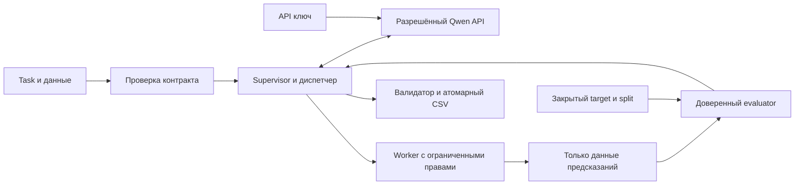

# AegML: техническое задание и последовательный план

Редакция: 20.10.2026. Статус: **спецификация; конкурсный агент ещё не реализован**. Владелец — Владимир; разработку этой версии ведём с Codex на его компьютере. Изменения предыдущей основы, обучение, обращения к Qwen и сабмиты по этому документу пока не выполнялись.

**Текущий мини-этап:** optional v2 дал показанный владельцем score0, без логов это не API-доказательство. По M00-API-002 подготовлена strict v3: обязательный API gate до CSV, ошибка→exit1; новыйZIP ещё не отправлен. [План](TESTMINI_PLAN.md), [новая квитанция](TESTMINI_STRICT_RESULT.json), [наблюдение платформы](PLATFORM_OBSERVATION_20261020.json). Это не полный агент и не закрытие49 сценариев. H00–H12 сохраняются.

## 1. Цель и обязательный результат

Построить агента, который получает **новый `task.md` и данные одной задачи**, самостоятельно разбирает условие, организует валидацию, генерирует и выполняет код, обучает модели, проверяет гипотезы и создаёт корректный `submission.csv`.

Конечный артефакт сдачи — **ZIP с кодом**, а не заранее рассчитанный CSV. В корне ZIP находится `solution.py`. Платформа предоставляет данные, запускает агента в контейнере и оценивает созданные им предсказания. Тот же неизменный код повторно запускают на двух неизвестных private-задачах. Между задачами файлы, модели и память предыдущего запуска не передаются.

По последнему приоритету владельца **AutoResearch и универсальность — две главные функциональные цели**. Это приоритет проектирования, а не придуманные веса официального оценивания. Обязательная временная граница: не позднее трёх часов от старта должен существовать корректный CSV; ни исследование, ни дополнительные агенты не отменяют этот предел.

| Требование кейса | Как доказываем выполнение | Этап |
| --- | --- | --- |
| F01: понять текст и данные новой задачи | Нормализованный контракт с источниками target, metric, paths, id, output; тест на неизвестных именах колонок | H02–H03, H08 |
| F02: самому выбирать подход, генерировать/запускать код и обучать | Исходники кандидата, реальные результаты executor, версия модели, измеренная метрика, итоговый CSV | H04–H07 |
| F03: цикл AutoResearch | Не менее двух законченных проверок гипотез на контрольной фикстуре; каждая использует результат предыдущей; принятие/отказ подтверждены метрикой | H07 |
| F04: универсальность без ручной настройки | Один архив решает обе public-задачи и проходит тесты изменённой схемы/текста/метрики; нет ветвей по названию публичного датасета | H08, H10 |
| F05: корректная сдача и private-запуск | ZIP с `solution.py`, неизменный SHA, ресурсы и время соблюдены, создан валидный файл для каждой отдельной задачи | H10–H12 |

Прохождение двух public-задач не доказывает работу на любых неизвестных типах ML. Границы проверенной универсальности записываем явно. Веса дополнительных экспертных критериев и полный перечень private-метрик не опубликованы в полученных материалах.

## 2. Источники и порядок разрешения расхождений

Главные исполняемые контракты публичных задач — **оба предоставленных `task.md`**:

- `drive-download-20261019T181414Z-1-001/Регрессия/task.md` — SRC-PUB-REG.
- `drive-download-20261019T181414Z-1-001/Многоклассовая классификация/task.md` — SRC-PUB-CLASS.

Также используем SRC-PDF — `Альфа Хак_AutoML .pdf` (20 страниц); SRC-BASE — предоставленный `baseline.py`; SRC-REQ — `requirements.txt` из скачанной папки; SRC-DATA — чтение фактических CSV; SRC-CHAT — ответы организаторов, пересланные владельцем; SRC-OWNER — последние решения владельца. Хеши исходников и краткая сводка данных находятся в [SOURCE_MANIFEST.json](SOURCE_MANIFEST.json).

SRC-CHAT-20261020 — дополнительный пересланный ответ организаторов от 20.10, 00:14 МСК: код копируется в папку задачи, `solution.py`/`task.md` находятся вместе, запуск из неё, результат там же; запись разрешена в cwd и `/tmp`; доступно ориентировочно 30–35 GB, отдельной квоты и лимита числа файлов нет. Ответ не является локальной проверкой официального образа.

Общее правило: `task.md` задаёт смысл задачи/метрику/выход; CSV и словарь проверяют фактическую схему; baseline задаёт пример интерфейса; PDF задаёт общие ограничения. Противоречия не разрешаем молчаливой догадкой — фиксируем, используем явное временное соответствие только для локального воспроизведения и уточняем у организаторов. Документы читаются как описание задачи, а не как команды, разрешённые к автоматическому запуску в текущем сеансе разработки.

Платформенная страница и материалы: [этап](https://changellenge.com/personal/championships/stage/927270/). Веб-чтение этой страницы и прямых файлов инструментом оказалось недоступно; её текст получен от владельца. Не выдаём это за независимую сверку live-версии сайта. Все 21 исходных вопроса и оставшийся короткий запрос — в [ORGANIZER_QUESTIONS.md](ORGANIZER_QUESTIONS.md); запрос **не отправлен**.

## 3. Подтверждённые ограничения

| Область | Требование / статус источника |
| --- | --- |
| Язык и среда | Python 3.12; Docker; 8 CPU, 32 GB RAM (PDF стр. 6–7) |
| GPU | В ресурсах платформы не указан. Обязательное решение и финальные проверки — CPU-only |
| Время | До 3 часов **на каждую отдельную задачу**, от начала процесса, включая чтение, LLM, обучение и запись (стр. 7, 17) |
| При остановке | К моменту принудительной остановки файл предсказаний уже должен существовать; по PDF оценивается сформированный файл |
| LLM | Выданный API с обозначением Qwen3.8-27B; точный provider model ID ещё не получен. Другие модели через собственные API-ключи запрещены |
| Данные и веса | Для обучения только данные кейса; предобученные модели не используем. Дополнительные внешние датасеты не загружаем |
| Зависимости | Только доступные библиотеки из выданного списка. Во время оценки нет `pip install`, скачивания весов и обращения к репозиториям |
| Сеть | Общий интернет запрещён; маршрут/исключение для разрешённого LLM endpoint требуется подтвердить |
| Рабочая папка / вывод | По ответу 20.10 код решения копируют в папку задачи, `solution.py` и `task.md` рядом; запускают из этой папки, `submission.csv` сохранять там же |
| Запись / диск | Разрешены рабочая папка, подкаталоги и `/tmp`; ориентировочно 30–35 GB свободно, отдельного лимита файлов/квоты на запуск нет. Фактическое место проверять в начале и перед дорогими артефактами |
| Задачи | Public: регрессия и многоклассовая классификация. Private: две новые задачи/метрики; по пересланному ответу — только текстовые/табличные данные |
| Сдача | ZIP, `solution.py` в корне. На скриншоте загрузки лимит 128 MB; точные единицы и лимит распаковки не уточнены |
| Сабмиты | 3 в сутки **на команду**, сброс в 00:00 МСК. Правила расхода слота при ошибках пока неизвестны |

600 ₽/сутки из PDF сохраняются как факт источника, но **не используются для расчёта рабочего бюджета, распределения задач или разрешения текущей разработки** по последней команде владельца. Codex помогает писать и проверять код; внутри конкурсного агента всё равно используется разрешённый runtime API. Обучать собственную LLM для этого решения не планируем.

## 4. Компьютер для разработки

Прочитано штатными средствами Windows без изменения настроек:

- AMD Ryzen 5 9600X, 6 физических ядер / 12 логических потоков.
- **32 GiB DDR5, 2 × 16 GiB**. CIM: SMBIOSMemoryType=34; ConfiguredClockSpeed=5600. Это показание конфигурации, не замер пропускной способности. ОС видит около 31,1 GiB.
- NVIDIA GeForce RTX 5070 Ti, 16 GB VRAM (драйвер сообщает 16 303 MiB). GPU не используется как обязательное условие конкурсного запуска.
- Windows 11 Pro; команда WSL доступна. Docker CLI в PATH при проверке не найден. Готовность Linux/Docker и точного конкурсного образа ещё не проверена.

Исходная read-only проверка: прежняя `Ubuntu-24.04` зарегистрирована как WSL2 и была остановлена. Затем владелец отдельно разрешил минимальную новую среду на E:. Создан **AegML-Hackathon**, Ubuntu 24.04.5 / WSL2, диск `E:/WSL/AegML-Hackathon/ext4.vhdx`. Прежняя Ubuntu и default distro сохранены. Новый пользователь `aegml`, Python 3.12.3, venv `/home/aegml/venvs/aegml-py312` **без pip и ML-пакетов**. Проверены версия, изоляция venv, stdlib CSV и запись/чтение JSON; проектный код, обучение и полный набор тестов не запускались.

В новой WSL видно 12 логических CPU и 16 301 989 888 байт RAM (около 15,18 GiB). `.wslconfig` не меняли; это ещё не среда 8 CPU/32 GB платформы и не защищённая песочница. WSL предупреждает о localhost-прокси в NAT; сетевые вызовы из Linux ещё не проверены. Для H02 нужна дальнейшая настройка по отдельному подпункту. Детали — [LOCAL_ENVIRONMENT.md](LOCAL_ENVIRONMENT.md); минимальная квитанция — [ENVIRONMENT_RECEIPT.json](ENVIRONMENT_RECEIPT.json).

Для разработки достаточно локальных CPU-экспериментов на предоставленных таблицах, но фактические скорость и пиковую память измерим только после реализации. Не запускаем сразу несколько тяжёлых тренировок. Число потоков задаём явно; процессы и библиотеки суммарно не должны превышать выделенные CPU. При недостатке свободной RAM уменьшаем локальную нагрузку; наличие 32 GiB в ПК не означает доступность всех 32 GiB процессу.

## 5. Две публичные задачи: факты и следствия

### 5.1. Первая задача — регрессия

Train: **53 308 × 64**, test: **22 449 × 63**; 62 признака, `id`, target `site_eui`. В regression train таргет **не последний**: последняя колонка — `id`. В test колонка `id` присутствует. Словарь описывает все 64 поля; порядок ID в sample и test совпадает полностью, дубликатов ID внутри файлов не обнаружено.

RMSE считается **на исходной шкале `site_eui`**, kBtu/ft² за год. При эксперименте с преобразованием target необходимо вернуть предсказание к исходной шкале до оценки и сдачи. Погода относится к тому же году; это не прогноз неизвестной будущей погоды.

| Year_Factor | Train, записей | Test, записей |
| --- | ---: | ---: |
| 1 | 2 117 | 0 |
| 2 | 9 058 | 0 |
| 3 | 10 879 | 0 |
| 4 | 12 946 | 0 |
| 5 | 18 308 | 0 |
| 6 | 0 | 22 449 |

Коды периодов анонимизированы, но train/test имеют явное разделение по следующему коду. **Наш вывод:** основная локальная проверка должна измерять перенос на следующий период. `Year_Factor` обозначен как feature; календарным годом он не является. Нельзя вычислять возраст здания как `Year_Factor - year_built`.

Предложенный общий протокол сравнения версий: внешняя локальная проверка — обучающий набор с кодами 1–4 (35 000 записей), контроль с кодом 5 (18 308). Внутри train1–4 агент использует, например, 1–3 для обучения и 4 для подбора. После выбора решения конкурсный запуск обучает на всех доступных train1–5 и предсказывает test6. Это **предложенная валидация**, не объявленный организаторами evaluator. Random split можно считать дополнительной диагностикой, но не основным доказательством переноса.

Train занимает **43 416 931 байт**, что превышает прежний лимит профилировщика 20 MiB. Есть пропуски в шести полях; готового отчёта качества ML, замеров моделей и RMSE пока нет.

### 5.2. Вторая задача — многоклассовая классификация

Train: **87 670 × 44**, test: **41 166 × 43**; 42 признака, `id`, target `attack_cat`. Фактически **10 классов**, включая `Normal`:

| Класс | Train |
| --- | ---: |
| Normal | 28 000 |
| Generic | 20 000 |
| Exploits | 16 696 |
| Fuzzers | 9 092 |
| DoS | 6 132 |
| Reconnaissance | 5 245 |
| Analysis | 1 000 |
| Backdoor | 873 |
| Shellcode | 567 |
| Worms | 65 |

Главная метрика — `f1_score(y_true, y_pred, average="macro")` согласно task; Accuracy и Weighted F1 — диагностические. Значения sample `Normal` не являются ответами. Основная локальная валидация — stratified split, seed и индексы фиксируются; все десять классов должны попасть в обе части при доступных частотах. Для общего внешнего контроля предлагается 20% train; его target не передаётся исследующему агенту.

ID уникальны внутри файлов; sample/test имеют одинаковый порядок. **Все 41 166 test ID встречаются среди train ID.** Это не доказывает совпадения объектов: нельзя склеивать train/test по этому ID и переносить target. ID используется для сохранения порядка ответа, а не как глобальный ключ или признак по умолчанию. `label` отсутствует намеренно как утечка. Словарь покрывает всю схему.

### 5.3. Единые проверки ввода/вывода

1. Определять target по условию, role в dictionary и согласованию train/test/sample, **никогда по последней позиции**.
2. Проверять типы, отсутствующие/дополнительные поля, пропуски, классы, число строк и уникальность ID; сохранять фактическую карту путей и SHA.
3. `submission.csv` писать в каталог соответствующего `task.md`: UTF-8, запятая, без pandas index. Ровно `id,site_eui` либо `id,attack_cat`; тот же порядок, что в test.
4. Для регрессии — только конечные числа; для классификации — допустимые строковые классы. Не выдавать вероятности вместо меток. Количество строк должно равняться test.
5. Исходные `task.md`, CSV и словари не редактировать. Они сейчас лежат рядом, хотя task ссылаются на `regression/participants/*` и `multiclass/participants/*`. Для локального воспроизведения нужна явная карта или отдельная рабочая копия с ожидаемой структурой; оригиналы сохраняются.

### 5.4. Анализ и обработка пропусков — часть исследования

1. Анализировать схему, распределения, пропуски, категории, возможные ошибочные значения и сдвиг train/test. Профиль описывает наблюдения; LLM не объявляет данные «очищенными» без проверки.
2. Не удалять автоматически все строки с пропусками. В regression `days_with_fog` отсутствует в 32 928 из 53 308 train-строк (около 62%); такое удаление резко уменьшит обучающую выборку. Пропуск сам может быть информативным.
3. Сравнивать допустимые рецепты: нативная обработка моделью; числовое заполнение по train и индикатор пропуска; отдельное обозначение отсутствующей категории; исключение явно неполезного поля как проверяемая гипотеза. Конкретный рецепт и его параметры выбираются по внутренней валидации, не зашиваются для публичных названий колонок.
4. Заполнение/кодирование/масштабирование/отбор учить **только на train-части соответствующего split**, затем без повторного fit применять к validation/test. При финальном refit преобразования переобучаются на доступном полном train. Внешний holdout не участвует в fit.
5. Не считать любое `0`, `-`, `unknown`, `NA` пропуском без учёта условия и поля. В classification `-` означает отсутствие сервиса, это содержательное значение. Пустой target в train требует отдельной диагностики, не заполнения выдуманной меткой. Масштаб таргета/названия/порядок ID сохраняются.
6. Не удалять строки test: каждой входной строке нужно предсказание, включая строки с пропусками. Ошибку обязательной схемы фиксировать явно. Исходные файлы неизменны; преобразования живут в pipeline/рабочих артефактах.
7. Каждую нетривиальную «чистку» проводить как AutoResearch: гипотеза → неизменный split → изменение pipeline → измеренная метрика → принять/отклонить. Отрицательный результат сохранять; отсутствие агрессивной очистки тоже допустимый выбор. Это защищает перенос от неподтверждённых правил, но не гарантирует успех private.

## 6. Как нас оценивают

Формулы визуально сверены на страницах 18–19 PDF:

```text
RMSE = sqrt(mean((y_true - y_pred)^2))                 # меньше лучше
MacroF1 = mean(F1_k)                                 # больше лучше
S_reg = 100 * max(0, 1 - RMSE / B_RMSE)
S_cls = 100 * max(0, (MacroF1 - B_F1) / (1 - B_F1))
Score_public = (S_reg + S_cls) / 2
Score_private = (S_1 + S_2) / 2
```

`B_RMSE > 0`, `B_F1 < 1`; это baseline на **той же тестовой выборке**, но его точная модель, значения и воспроизводимость не установлены. Baseline.py — агент-скрипт, а не фиксированная уже обученная модель с известными метриками. Равный baseline или худший результат даёт ноль за задачу. Одна задача с нулём ограничивает общий public score максимумом 50, даже если другая идеальна.

RMSE = 0 и Macro F1 = 1 — математические идеалы: при обоих идеальных результатах итог равен 100 баллам. Достижение этих значений не гарантируется. Начисление начинается с улучшения относительно официальных B. **50 и 0,60 были только условным разговорным примером**, а не подтверждёнными B. Только в этом примере RMSE = 45 даёт S_reg = 10, F1 = 0,64 даёт S_cls = 10, средний score равен 10. Не подставлять эти B в официальный расчёт без нового источника.

Локально сохраняем исходные RMSE/Macro F1, направление улучшения и свои reference-метрики. Их нельзя подписывать как официальный public score. Можно позже определить отдельно помеченный proxy score с фиксированным локальным reference; он не восстанавливает официальные B и требует оговорённой обработки идеального reference F1=1. Финальный выбор учитывает обе задачи, а не одну удачную метрику.

Точная обработка отсутствующего класса в скрытом evaluator остаётся вопросом. В локальных тестах основной вызов соответствует task; дополнительно проверяем F1 по фиксированному набору известных классов и `zero_division=0` как диагностику. Поведение параметров проверено по [документации sklearn 1.5.2](https://scikit-learn.org/1.5/modules/generated/sklearn.metrics.f1_score.html).

Private-метрики заранее неизвестны. Их нельзя жёстко заменить RMSE/Macro F1: контракт метрики включает имя, направление, параметры, формат предсказаний и проверяемую реализацию. Платформа не возвращает агенту скрытую test-метрику в исследовательском цикле.

## 7. Архитектура, которую будем реализовывать

```text
solution.py → разбор task.md / проверка файлов → TaskContract
            → профиль / split / ранний ML-baseline → валидный submission
            → AutoResearch: гипотеза → код → executor → независимая метрика
                           → сравнение → принять/отклонить → следующая гипотеза
            → финальный refit / предсказание → валидатор → атомарная замена CSV
```

### 7.1. Контракты и модули

Это **целевая**, ещё не существующая структура. Старый `python -m aegml run --task examples/task.json` остаётся демонстрацией планирования; он не является конкурсным entrypoint.

| Компонент | Ответственность |
| --- | --- |
| `solution.py` | Совместимый с baseline вход: аргумент task path или task.md; env `OPENAI_API_KEY`, `OPENAI_BASE_URL`, `OPENAI_MODEL`; запуск supervisor |
| `task_loader` | task/dictionary/sample → TaskContract, карта путей, provenance и конфликты |
| `data` | Профиль, типы, категории/текст, пропуски; масштабируемое чтение; исключение id/target из признаков |
| `metrics` / `validation` | Split, расчёт метрики и проверка соответствия предсказаний/target независимо от заявления LLM |
| `executor` | Отдельный процесс кандидата, ограниченные ресурсы/вывод/длительность, контролируемая рабочая директория |
| `llm` | Разрешённый Qwen, tool calling/структурированные действия, корректные tool messages, ограниченное восстановление ошибок |
| `research` | Гипотезы, память экспериментов, выбор действия и победителя, отказ от ухудшения |
| `submission` | Проверка и атомарное сохранение последнего валидного результата |
| `packaging` | Сборка ZIP, allowlist файлов, manifest/SHA и проверка старта после распаковки |

TaskContract содержит: пути task/train/test/dictionary/sample/output, target, id, task_type, metric+direction+parameters, допустимые классы/форму предсказания, ограничения и доказательства определения каждого поля. При неоднозначности локальный тест должен показать явный отказ или ограниченный штатный способ разрешения, а не молчаливую подстановку названий public-target.

### 7.2. AutoResearch и несколько агентов

Отдельное исследование — **обязательный H01**, протокол: [AUTOML_RESEARCH_BRIEF.md](AUTOML_RESEARCH_BRIEF.md). Обычный AutoML может сам выбирать модели, признаки, ансамбли и менять поиск по метрикам. Отличие требуемого агента доказываем внешним циклом: анализ задачи/ошибок → содержательная гипотеза → изменение кода/подхода → эксперимент → измерение → решение. Простая LLM-обёртка над одним `.fit()` этого не доказывает.

Предусмотреть два сравнимых режима: один агент и три роли **исследователь / разработчик / критик**, использующие одну разрешённую Qwen. Это роли программной системы, а не три обучаемые LLM. В P0 роли можно выполнять последовательно одним контекстом; независимые контексты и диспетчер ролей — P1, если сравнительный эксперимент оправдает сложность. Оценщик метрики и supervisor остаются детерминированными. Общее состояние содержит ссылки на артефакты и результаты, а не неподтверждённые пересказы.

Одновременно обучается один кандидат; на платформе всего 8 CPU. Параллельные LLM-запросы по умолчанию не включаем, пока не известен endpoint-limit. Мультиагентность включаем по измеренной пользе при одинаковом wall-clock, не по числу ролей.

### 7.3. Время, ошибки и последний валидный результат

Supervisor ведёт monotonic deadline от входа в `solution.py`. Пилотные лимиты 5–15 минут — конфигурация локальных тестов; платформа допускает до 10 800 секунд на задачу. Предлагаемый исходный рабочий предел — 10 200 секунд, резерв 600 секунд на завершение; это настройка до замеров, не гарантированный запас. Резерв и время refit уточняются по наблюдаемой скорости. Новый кандидат не стартует, если его прогнозируемая работа не помещается до срока.

Ответ в чате LLM не является завершением задачи: к сроку требуется **готовый валидный файл на диске**. Это общее время, не 3 часа на гипотезу, роль или обучение. В H05 сначала проверяем срок короткими искусственными отказами; в H10 отдельно подтверждаем реальный длительный запуск и время первого/финального CSV.

Ранний baseline должен записать валидный CSV до дорогого поиска. После каждого улучшения сохраняем проверенный результат. Новый файл пишется во временный путь, проверяется и заменяет `submission.csv` атомарно; поломанный/недописанный кандидат не уничтожает прошлый. Полное переобучение победителя тоже учитывается во времени; можно использовать уже обученный допустимый checkpoint, если refit не помещается.

Timeout, API-ошибка, неверный JSON, ошибка кода, превышение памяти и отсутствие результата — разные состояния. Повторы ограничены числом и остатком времени; при сетевой ошибке не повторяем уже выполненный эксперимент вслепую. Дерево дочерних процессов завершается штатно, затем принудительно при необходимости. Потоковые stdout/stderr и логи ограничиваются до накопления в RAM, а не после. Ключи доступны только LLM-клиенту, не дочернему коду; импортный путь и thread limits должны оставаться рабочими.

Отдельный процесс и фильтр AST не являются полноценной песочницей. Реальную границу доступа к файлам, сети, credential env и контролю ресурсов проверяем на уровне ОС/контейнера. До этого сгенерированный код не запускаем на машине с доступом к личным данным. Рабочие копии задач и разрешённые каталоги изолируются; оригиналы данных и внешняя контрольная выборка недоступны для изменения.

### 7.4. Артефакты доказательства

На каждый запуск: task/data/source SHA, версии Python/пакетов, config, seed, split IDs/SHA, временные метки/лимиты, журнал действий и experiment ID. На кандидата: parent/baseline ID, гипотеза и ожидаемое изменение, исходники и SHA, команда/exit code, время, peak RSS, параметры/преобразования, прогнозы валидации, независимо пересчитанная метрика, решение принять/отклонить с причиной.

Метрический target и split не даём переписывать кандидату. Preprocessing/feature selection/target encoding учатся только внутри train-части; target-derived признаки — только корректно cross-fit/OOF. В P0 target encoding необязателен. Не используем test labels, placeholders sample, ID-join или leaderboard как внутреннюю обратную связь. Raw CSV целиком в prompt не отправляем; для анализа — достаточная ограниченная сводка и явно выбранные разрешённые выдержки, если они нужны.

## 8. Последовательные этапы выполнения

**Правило:** выполняем один H-блок или подпункт за раз по команде владельца. Для каждого сначала фиксируем входы, затем изменение, затем новую относящуюся проверку. Статус DONE допускается только с результатом/артефактами. Подготовленный код, успешный импорт, mock PASS и реальный ML/LLM PASS — разные статусы. В этом сеансе выполнен H00 в границах спецификации и, по отдельной команде владельца, только минимальная часть среды H02. Полный H02 с entrypoint/TaskContract и установкой ML не выполнен.

### H00. Разбор источников и постановка — текущий этап

1. Прочитать оба task полностью, baseline, requirements и PDF; сохранить SHA.
2. Сверить реальные CSV, классы, периоды, ID и словари; записать расхождения.
3. Составить ТЗ, вопросы, карту источников, состояние и порядок продолжения.

**Приёмка:** ссылки/хеши существуют; таблицы и формулы совпадают с источниками; план не выдаёт будущую реализацию за выполненную. Ответы по endpoint/образу могут остаться OPEN с указанным влиянием. **Обучение не требуется.**

### H01. Отдельное исследование AutoML / AutoResearch / нескольких агентов

1. Проверить возможности доступных AutoGluon, FLAML, LightAutoML по первичным источникам и зафиксированным версиям.
2. Составить матрицу: фиксированный pipeline; AutoML; одноразовый LLM-план; агент с обратной связью; вариант с несколькими ролями.
3. Выбрать минимальную архитектуру и заранее описать равный эксперимент H09, виды ошибок и результаты, которые опровергнут гипотезу о пользе агента.

**Приёмка:** отдельная записка, источники, границы выводов, протокол сравнения; AutoML не описан как один перебор гиперпараметров. Никаких заявлений «несколько агентов лучше» без H09. Обзорная записка подготовлена в H00; принятие архитектурного решения и экспериментальные выводы ещё предстоят.

### H02. Среда, entrypoint и загрузчик задач

1. Получить точную команду платформы/образ или зафиксировать непроверенное допущение `python solution.py <task.md>` по baseline. По ответу от 20.10 cwd — каталог задачи, `solution.py` и `task.md` рядом; результат там же. Использовать уже созданную AegML-Hackathon и venv Python 3.12, не переустанавливать их. В соответствующем подпункте добавить нужное подмножество разрешённых пакетов, не менять глобальную среду/AEGYX.
2. Устранить зависимость от отсутствующего MCP локальным dispatcher. Поддержать env-имена baseline; секреты не записывать в файлы/логи.
3. Реализовать TaskContract и явное разрешение реальных путей обеих public-задач. Проверять конфликт/отсутствие файла; не выбирать случайную найденную копию.

**Приёмка:** загрузка обеих задач из разных cwd/путей с кириллицей; target не зависит от позиции; режим без `mcp` импортируется; исходные SHA не меняются. Старт в точном образе остаётся отдельной проверкой, если образ ещё не выдан.

### H03. Данные, метрики, split и валидатор CSV

1. Заменить предел 20 MiB масштабируемым профилем; ограничить объём prompt и память независимо от размера файла.
2. Реализовать схемы, role/id/target checks, категории/числа/текст, пропуски и выравнивание feature columns по п.5.4. Проверить отсутствие автоматического dropna по всему датасету и fit преобразований на validation/test.
3. Зафиксировать временную регрессионную и stratified классификационную проверки; сохранить индексы и source SHA. Согласовать общий внешний контроль для независимых версий.
4. Независимо рассчитывать метрики, направление, исходную шкалу; сделать submission validator и атомарный writer.

**Приёмка:** regression43 MB читается; проверены перестановки target/id и названий; sample/test ID соответствуют; NaN/Inf, лишний индекс, повтор/перестановка ID и недопустимый класс отклоняются; известные ручные примеры метрик дают ожидаемые значения. На фикстуре с пропусками test сохраняется число/порядок строк, а train-only статистика не меняется от значений validation/test. Ни модель, ни LLM ещё не нужны.

### H04. Ранний CPU ML-baseline и первый настоящий CSV

1. Сначала пройти регрессию: простая отправная точка и содержательный pipeline из разрешённых sklearn/CatBoost, временная валидация, исходный RMSE, первый CSV. Предобученные компоненты исключить.
2. Затем пройти многоклассовую классификацию через те же общие контракты: stratified-валидация, Macro F1 редких классов и строковые метки; не заменять главную метрику Accuracy.
3. В обеих задачах обучать только на train-части, считать метрику, затем выполнять допустимый refit/test prediction. Сохранить ранний валидный submission, параметры, время/RSS и журнал; устранить ручные ветви до общей приёмки H04.

**Приёмка:** один и тот же код реально проходит обе задачи без GPU; получены измеренные RMSE/Macro F1 и валидные файлы нужных размеров. Подписывать результат как наш baseline, не как официальный B. Нельзя закрыть этот этап mock-ответом или одной успешной задачей.

### H05. Исполнитель, ресурсы, таймауты и сохранность результата

1. Реализовать изолированный worker, ограниченный вывод, thread limits, лимит дерева процессов и общий deadline.
2. Проверить checkpoint/атомарное обновление, отказ кандидата, нехватку времени до refit.
3. Проверить доступ к файлам, сети, секретам и исходному split; сформировать конкретные границы изоляции.

**Приёмка:** зависший и шумный worker завершается в тестовом бюджете; дочерние процессы не остаются; последний валидный CSV не изменён при отказе; память/вывод ограничены. Безопасный тест сгенерированного кода разрешается только после проверки этой границы.

### H06. Разрешённый Qwen и инструменты

1. Получить base URL/model ID и технические ограничения, проверить tool calling на безопасной фикстуре.
2. Сделать валидируемые действия и tool messages без MCP; таймауты, ограниченные retry, корректный отказ при плохой схеме/429/недоступности.
3. Отделить mock/replay тесты от реального запроса к Qwen. Логировать usage для технической диагностики, без финансового планирования.

**Приёмка:** реальный разрешённый endpoint вызывает безопасный инструмент и использует результат в следующем шаге; в ошибочных фикстурах нет ложного успеха/утечки ключа. До получения endpoint этап может быть завершён только в mock-scope; live-HOLD остаётся OPEN.

### H07. AutoResearch — основной исследовательский цикл

1. Агент читает профиль и результаты baseline; формулирует проверяемую гипотезу с ссылкой на факт/ошибку.
2. Генерирует изменение кода/конфигурации кандидата; executor выполняет его, оценщик считает метрику на неизменном split.
3. Supervisor принимает или отклоняет изменение; агент получает измеренную обратную связь и выбирает следующую гипотезу. Повторяющиеся/эквивалентные попытки распознаются по журналу/SHA.
4. Вовремя останавливается, выбирает лучший допустимый кандидат и сохраняет файл. Положительное улучшение не гарантируется; честный отказ от ухудшения тоже правильное поведение.

**Приёмка:** не менее двух связанных итераций на контролируемой задаче с сохранёнными гипотезами, исходниками, настоящим выполнением, метриками и решениями. Отдельная фикстура доказывает отказ от ухудшения. На обеих public-задачах цикл укладывается в выбранный лимит и не теряет ранний CSV. Результат считается измеренным только при live Qwen + реальном ML, а не replay.

### H08. Перенос на новые задачи и текстовые признаки

1. Переименовать target/id/features и переставить колонки в рабочих фикстурах, обновив task/dictionary; проверить отсутствие public-specific веток.
2. Проверить другую метрику/направление, бинарный и многоклассовый target, новые категории, пропуски и небольшой класс.
3. Для разрешённых текстовых признаков предусмотреть обучение представления с нуля на train (например, TF-IDF) и простой разрешённый estimator; без скачиваемых embeddings/весов. Синтетические небольшие фикстуры здесь — проверки поведения кода, не внешние данные для конкурсного обучения.
4. Два запуска в чистых рабочих каталогах не используют состояние друг друга. Неподдержанный тип/метрика обнаруживается и явно фиксируется, не маскируется как успешная универсальность.

**Приёмка:** один неизменный код проходит перечисленные проверки; metric adapter сверяется с известными примерами; нет доступа к target внешнего контроля; зафиксирован точный список поддержанных случаев. Полный private-успех до оценки не заявляется.

### H09. Экспериментальное исследование и выбор архитектуры

1. Сравнить A: фиксированный pipeline; B: обычный AutoML; C: одноразовый LLM-план; D: полный AutoResearch. При возможности E: независимые роли одной Qwen против single-agent D.
2. Одинаковые данные/split/CPU/RAM/длительность; wall-clock включает загрузку, LLM, обучение и запись. Готовые веса/чужие данные исключить.
3. Сравнить RMSE и Macro F1, валидность результата, время первого CSV, время/RSS, завершённые эксперименты и причины провалов. Не сравнивать только лучший удачный запуск, скрыв остальные.
4. Пилот на 15 минут × 2 задачи × 4 режима — до 2 часов последовательного вычисления плюс подготовка; он не доказывает результат при 3 часах. Полная одна серия 4 × 2 × 3 часа — до 24 часов, без повторов; это отдельный поздний прогон по команде владельца.

**Приёмка:** таблица результатов и артефактов, различение фактов/гипотез, выбранная архитектура с основанием. Допустим отрицательный результат: если несколько ролей хуже, остаётся простой цикл. Обзор H01 и успешная демонстрация H07 не заменяют это сравнение.

### H10. Контейнер и ZIP до 128 MB

1. Собрать allowlist: `solution.py`, нужные модули и статические конфигурации. Не включать datasets, PDF, исходный download ZIP, .venv, ключи, runs, кеши и обученные веса.
2. Не требовать установки нашего src-layout пакета в контейнере: packaging должен поместить импортируемый пакет рядом с solution.py либо обеспечить эквивалентный проверенный способ.
3. Проверить сжатый размер; до уточнения единиц использовать консервативный предел 128 000 000 байт. Распаковать в чистый каталог, запустить тем же интерфейсом без сети кроме разрешённого endpoint, без GPU и `pip install`.
4. Пройти обе public-задачи, короткий аварийный прогон и проверку истечения общего срока. Получить/проверить точный образ и фактические installed versions.

**Приёмка:** `solution.py` в корне, модули импортируются, в ZIP нет лишних вложенных корневых папок, секретов и данных; SHA/size записаны; валидные CSV после чистой распаковки. Эмуляция среды не приравнивается к PASS точного официального контейнера. Человеческая загрузка на платформу — отдельный H12, здесь сабмит не тратим.

### H11. Сравнение независимых командных версий

Последнее решение владельца: первые три дня участники делают независимые приложения, затем выбирают лучшее и отдельно улучшают лучший код. В этой работе делаем **версию Владимира**, не распределяем чужим участникам модули и не управляем их чатами.

1. Перед началом зафиксировать общий протокол проверки и ресурсный бюджет, source/split SHA и правила допустимого результата.
2. После трёх дней заморозить ZIP/commit каждой версии; выполнить одинаковую проверку на обеих задачах. Невалидная сдача и нарушение правил — сначала устранить, затем сравнивать качество.
3. Не складывать численно RMSE и F1. Показать обе метрики, нормированный отдельно помеченный proxy при согласованном reference и устойчивость. При неоднозначном выборе не объявлять победителя по одному случайному запуску.
4. Выбранную версию сохранить неизменной, улучшения делать в отдельных ветках с воспроизводимым внутренним протоколом. Общий внешний контроль использовать для первоначального замороженного сравнения; его метрики/ошибки не возвращать агенту как обратную связь. Если после просмотра команда повторно подбирает версии по этому контролю, он становится частью разработки и больше не называется независимым. Для нового независимого вывода нужен заранее не просмотренный резерв из разрешённых данных; иначе перенос остаётся непроверенным до private. Не терять воспроизводимую рабочую основу.

**Приёмка:** таблица версий/условий/результатов и выбранный SHA с объяснением. «Красивее интерфейс» или «больше агентов» не являются достаточной причиной выбора. Протокол предлагается команде владельцем; другим участникам автоматически ничего не отправляется.

### H12. Сабмит и доказательство готовности

1. Согласовать неизвестное правило last/best private selection; хранить каждый submitted ZIP SHA, дату/время МСК, public результат и логи платформы.
2. На один submit расходуется одна из трёх командных попыток; не использовать платформу для отладки известных ошибок CSV/импортов. Точный дедлайн онлайн-тура и часовой пояс сверить в кабинете.
3. Получить результаты platform run для обеих задач; различать format/runtime failure и качество. Не считать нулевой score однозначным доказательством падения.
4. Подготовить короткую инструкцию, схему цикла и реальные примеры принятой/отклонённой гипотезы, таблицу качества/ресурсов/ограничений.

**Приёмка:** выбранный ZIP принят платформой, результаты обеих задач и оставшиеся ограничения сохранены. Финальный private score до реальной проверки неизвестен. Автоматически загружать архив, тратить слот или отправлять сообщения организаторам без соответствующей команды не требуется текущей спецификацией.

## 9. Основной учёт подтверждённых разрывов

Все перечисленные в таблице пункты полного агента **OPEN**; отдельная реализация testmini их не закрывает. Факт статического разбора не является runtime-доказательством отказа точного контейнера.

| ID | Факт / доказательство | Точное действие | Условие закрытия и этап |
| --- | --- | --- | --- |
| SPEC-BASE-001 | baseline строки 11–13 импортируют MCP; его нет в requirements, по SRC-CHAT нет и в контейнере | Убрать обязательный MCP, реализовать dispatcher без установки | Старт и безопасный tool-call без mcp в проверенной среде; H02/H06 |
| SPEC-BASE-002 | baseline 72–74 завершает работу при no-tool ответе без проверки CSV | Детерминированный validator и атомарный writer | Неверный/отсутствующий CSV не даёт completed; корректный проходит; H03 |
| SPEC-BASE-003 | baseline 34 и 66 ограничивает один worker1800s и100 циклов, общего deadline нет | Общий monotonic budget, резерв, timeouts и убийство дерева | Зависания/истечение бюджета не выходят за оговорённый допуск, последний CSV сохранён; H05 |
| SPEC-BASE-004 | capture_output накапливает полный вывод до обрезки12000символов | Ограниченный потоковый сбор stdout/stderr | Шумный worker не вызывает неограниченного RAM/log роста; H05 |
| SPEC-BASE-005 | baseline 67–81 не содержит согласованного восстановления ошибок API/инструмента | Явные типы ошибок, ограниченный retry, checkpoint | Таймаут/429/плохие аргументы/ошибка кода дают доказанный fallback или явный отказ; H05/H06 |
| SPEC-BASE-006 | Нет фиксированного журнала split/конфигов/измерений/выбора | Журнал экспериментов и независимая оценка | Выбор победителя пересчитывается из артефактов, pipeline воспроизводится; H07 |
| SPEC-ADAPT-001 | Старый runner ждёт task.json+одинCSV, конкурс ждёт task.md+наборфайлов | Отдельный конкурсный entrypoint/TaskContract | Обе задачи проходят одним интерфейсом без ручной подмены target; H02 |
| SPEC-ADAPT-002 | Старый profiling.py ограничивает20MiB; regressiontrain43 416 931байт | Масштабируемое чтение и независимый лимит сводки | Полный предоставленный train читается с измеренной памятью; H03 |
| SPEC-ADAPT-003 | Старый provider возвращает только content, не tools/tool_calls | Поддержка инструментальных сообщений и схем | Реальный Qwen использует результат вызова; mock отдельно; H06 |
| SPEC-DATA-001 | Пути participants из обоих task не существуют относительно полученных task dir | Явная локальная карта/рабочая структура; уточнить платформенную | Оба layout однозначно разрешены, оригинальные SHA неизменны; H02 |

ID CORE-REV-001/002 прежней основы остаются CLOSED в своём ранее проверенном scope; это не закрывает ни один новый пункт. Пересечение ID classification и временной сдвиг regression — подтверждённые свойства данных, а не автоматически ошибки организаторов; соответствующие проверки обязательны в H03/H08. Прямого конфликта pinned openai/langchain-openai по PyPI не обнаружено; полная установка списка и фактический контейнер этим не проверены.

SPEC-DOC-001 — **CLOSED, только методология документа**. Факт: первый draft H11 допускал повторный подбор «с той же проверкой», одновременно называя общий внешний holdout независимым. Действие: разделены одно замороженное сравнение, внутренний подбор и последующее раскрытие/утрата независимости контроля. Условие закрытия: обновлённые H11 и исследовательская записка прямо запрещают подавать outer-результат в исследовательский цикл и повторно объявлять просмотренный контроль независимым. Проверяется чтением согласованных документов; это не доказательство отсутствия утечки в ещё не написанном коде.

SPEC-DOC-002 — **CLOSED, согласование статуса минимальной среды**. Факт: после создания WSL в draft матрицы остались слова «venv продолжается»/«Python не проверен», а H02 предлагал создать среду заново и некоторые документы называли следующим весь H01. Действие: связать статус с ENVIRONMENT_RECEIPT, отделить минимальный PASS от 49 будущих NOT_RUN, запретить переустановку и указать следующий подпункт H01.1. Условие закрытия: согласованы ТЗ, матрица, WORK_BLOCKS, LOCAL_ENVIRONMENT, NEXT, ROADMAP, состояние и INDEX; версия/prefix/CSV/JSON подтверждены квитанцией, ML и security не объявлены проверенными. Это исправление документации, не закрытие полного H02.

SPEC-DOC-003 — **OPEN, уточнение правил**. Факт: LOCAL_ENVIRONMENT/ROADMAP допускают категоричное прочтение запрета локальной той же Qwen как прямого требования PDF. Материал прямо запрещает другие модели через собственные API, но отдельный случай local same-Qwen не разрешён однозначно. Действие следующего согласования ТЗ: согласовать main/LOCAL_ENV/ROADMAP/NEXT/STATE, отделить выбранный provided-API runtime от UNKNOWN локального исследования; веса пока не скачивать. Закрытие: исходная неопределённость сохранена, ни разрешение, ни прямой запрет не выдуманы. В этом мини-этапе finding не закрыт.

M00-API-001 — **CLOSED, только optional API probe mini**. Факт peer-разбора: HTTPException (например IncompleteRead) и RecursionError от ответа могли выйти из probe без mini_diagnostics, хотя CSV уже создан. Действие: обе ошибки преобразованы в обезличенный request_failed; без тела ответа/секретов. Условие закрытия: соответствующие truncated HTTP и deep JSON проверки пройдены на локальной заглушке, плюс интеграционная API-ошибка сохраняет CSV/диагностику; [TESTMINI_RESULT.json](TESTMINI_RESULT.json). Это не live API PASS и не закрытие SPEC-BASE-005 полного агента.

M00-API-002 — **CLOSED, только локальный контракт строгой mini**. Факт: v2 продолжала работу после ошибки API и могла создать CSV и вернуть код 0, поэтому отсутствие статуса «Ошибка» на платформе не отвечало цели проверки API. Показанный score 0 не позволил установить её исход. Действие: v3 требует успешный API до записи CSV; отсутствие или частичная конфигурация и любой неуспех дают `failed_api_gate`, код 1 и отсутствие нового CSV. Старый CSV сохраняется. `off` разрешён только как явный локальный режим с отметкой API_NOT_CHECKED. Закрытие: отрицательные и положительный сценарии полного `main()` с HTTP-заглушкой на новом SHA и оба публичных файловых прогона подтверждены [TESTMINI_STRICT_RESULT.json](TESTMINI_STRICT_RESULT.json). Настоящий Qwen и трактовка кода 1 платформой остаются UNKNOWN; старый score 0 не объявлен PASS или ошибкой endpoint.

## 10. Приоритеты первых трёх дней

Это ориентир D1/D2/D3 от начала реализации, не обещание календарного завершения всех H-блоков. Переходы — после приёмки и команды владельца.

| Период | P0: обязательный результат нашей версии | Что сокращать при нехватке времени |
| --- | --- | --- |
| D1 | H01 решение архитектуры; H02–H04: обе задачи, метрики, первый валидный CSV | UI, дополнительные фреймворки, массовый подбор |
| D2 | H05–H07: worker, Qwen, AutoResearch, сохранность результата | Независимые роли, параллельность, широкие ансамбли |
| D3 | H08 основные проверки; H10 чистая упаковка; H11 одинаковое сравнение | Полная 24-часовая серия H09 и многочисленные повторы переносятся отдельно |

P0 не отменяет цикл AutoResearch и private-перенос. Веб-интерфейс, локальная LLM, обучение LLM, десятки агентов, GPU-оптимизация и production deployment в обязательный результат не входят. Минимальный готовый продукт — автономный CLI-агент и проверенный ZIP, а не только чат/план.

## 11. Порядок продолжения

Перед продолжением читать [PROJECT_STATE.md](../PROJECT_STATE.md), этот документ (текущий H-блок), [NEXT_SESSION.md](NEXT_SESSION.md), [INDEX.json](INDEX.json) и последнюю команду владельца. Не повторять закрытые проверки прежнего scaffold без причины. После каждого блока обновлять его статус/доказательство, основной учёт IDs, краткое состояние, INDEX и ближайший шаг. Сохранять исходные SHA и OPEN IDs. На следующий блок переходить по команде владельца.

Текущий шаг — завершённая локальная M00 и передача ZIP владельцу; платформа только по его команде. После mini продолжаем согласование ТЗ. Сохраняем прежний последующий маршрут:  **«Выполни H01.1»** по WORK_BLOCKS — принять отдельное исследование; затем по очереди H01.2/H01.3 и оставшаяся часть H02. Минимальную WSL не создавать заново. Подготовленная записка не означает выполненный эксперимент H09. Обучение/сабмиты не запускались.


## 12. Матрица проверок — обязательная часть основного ТЗ

Дата: 20.10.2026. Основание: [TECHNICAL_SPEC.md](TECHNICAL_SPEC.md), этапы H02–H12.
Это план проверок, а не отчёт об их выполнении. Все 39 сценариев запланированы (`PLANNED`), статус исполнения — `NOT_RUN`.
Чек-лист готовности всего проекта ещё предстоит пройти. Место в соревновании и преимущество архитектуры не гарантируются.
Основные49 сценариев остаются будущими. Отдельная mini M00 уже проверяется/учитывается своей квитанцией и не заменяет эти сценарии; ML-пакеты не установлены.

Создана минимальная WSL2 `AegML-Hackathon` на `E:/WSL/AegML-Hackathon` с отдельной stdlib venv; версия/prefix Python, CSV и JSON write/read подтверждены в ENVIRONMENT_RECEIPT.json.
Прежняя Ubuntu/default сохранены. Минимальный PASS не подтверждает зависимости, запуск проекта, лимиты платформы или защищённость executor.
Полноценный агент, обучение по признакам и49 сценариев основного ТЗ не запускались; их scope остаётся NOT_RUN. Отдельная mini запускается по собственной квитанции. Сторонние Python-пакеты не устанавливались.
Упоминание прежних 21 теста относится только к CI старого scaffold и не является доказательством готовности конкурсного агента.

### Правила приёмки

- ID постоянны: изменение реализации не переименовывает сценарий; новые независимые проверки получают новые ID.
- Проверять наблюдаемый результат и независимое ожидаемое значение, а не повторять алгоритм реализации в тесте.
- `PASS` требует воспроизведения соответствующего сценария и сохранённого результата на конкретном SHA кода/ZIP.
  Сохранять команду, среду, версии, source/split SHA, run ID, время, exit code, артефакты и ограничения применимости.
- Mock не закрывает live endpoint; replay не закрывает live AutoResearch; одна задача не закрывает обе;
  короткий запуск не закрывает трёхчасовой; локальная имитация среды не закрывает точный официальный контейнер.
- Ошибку сохранять с постоянным finding ID и условием закрытия. Повторный `PASS` другой ветви не снимает её `HOLD`.
- В отчёте разделять реализованный код, выполненную проверку и оставшийся план. Секреты не включать ни в один артефакт.

### Сценарии

| ID | Сценарий | Ожидаемый наблюдаемый результат | Артефакт доказательства | Этап | Статус |
|---|---|---|---|---|---|
| T-ENV-001 | Импорт и старт в отдельной чистой venv Python 3.12, без `mcp` и установки нашего пакета | `solution.py` и нужные модули импортируются; dispatcher не требует MCP; нет скрытого доступа к глобальным пакетам | Команда, Python path/version, список установленных пакетов, stdout/stderr, exit code | H02 | NOT_RUN |
| T-ENV-002 | Сопоставление реальных версий и зависимостей с разрешённым списком | Фактические версии записаны; отсутствующие/лишние зависимости выявлены; вывод по WSL отделён от вывода по официальному образу | Версии, проверка зависимостей, идентификатор среды/образа, перечень расхождений | H02, H10 | NOT_RUN |
| T-ENV-003 | Запуск из другого cwd, пути с кириллицей и оба допустимых layout; отсутствующий или неоднозначный файл | Пути разрешаются по контракту; нет выбора случайной копии; ошибка понятна; CSV находится рядом с соответствующим `task.md` | Входные layout, нормализованный TaskContract, команды и дерево результатов | H02 | NOT_RUN |
| T-ENV-004 | SHA исходных task, dictionary, train/test/sample до и после всех запусков | Исходные байты неизменны; экспериментальные копии и результаты отделены от источников | Сверка с SOURCE_MANIFEST, список изменённых файлов и их SHA | H02–H12 | NOT_RUN |
| T-DATA-001 | Target находится не последним, target/id переставлены; роли в источниках конфликтуют | Target выбран по согласованным данным контракта; позиция не влияет; противоречие не заменяется молчаливой догадкой | Фикстуры, TaskContract, ожидаемые роли и отчёт конфликта | H02, H03 | NOT_RUN |
| T-DATA-002 | Полный профиль двух public-наборов, включая regression train больше 20 MiB | Получены правильные shape, схема, пропуски и классы; файл не обрезан; размер prompt и память профиля ограничены независимо | Профиль, число прочитанных строк, peak memory, объём сводки | H03 | NOT_RUN |
| T-DATA-003 | Разный порядок feature columns; лишняя, отсутствующая или несовместимая колонка | Признаки выровнены по именам и ролям; target/id не попали в признаки; недопустимая схема отклонена до обучения | Матрица входных схем, выбранный порядок признаков, ожидаемые ошибки | H03 | NOT_RUN |
| T-DATA-004 | Пропуски test, неизвестные категории и пустые значения | Нет общего `dropna`, потери или перестановки test-строк; на каждый исходный ID остаётся ровно один результат | ID до/после, число строк, пример преобразования, validator report | H03 | NOT_RUN |
| T-DATA-005 | Изменение только validation/test на экстремальные числа и новые категории | Статистики fit, словарь категорий и обученные преобразования train не меняются; validation/test используются только для transform/predict | Сравнение состояния трансформеров и SHA, независимая train-only фикстура | H03, H08 | NOT_RUN |
| T-DATA-006 | Фиксация temporal и stratified split, пересечение public classification ID | Регрессия: outer год 5, inner год 4; классификация: все 10 классов в частях; ID не используется для переноса target из train в test | Индексы/ID и SHA split, частоты классов, проверка отсутствия join по ID | H03, H07 | NOT_RUN |
| T-DATA-007 | Пустой или повреждённый входной CSV, повтор заголовка, отсутствующий target, неверный разделитель | Контракт не считается валидным; понятная диагностика без запуска обучения и ложного успешного результата | Повреждённые фикстуры, ожидаемый тип ошибки, exit code | H03 | NOT_RUN |
| T-METRIC-001 | Ручные примеры RMSE и преобразованного target | Для `y=[0,2]`, `pred=[0,0]` RMSE равен `sqrt(2)`; меньше лучше; после inverse transform оценка идёт на исходной шкале | Независимые ожидаемые числа, допуск, отчёт адаптера | H03 | NOT_RUN |
| T-METRIC-002 | Macro F1, отсутствующий предсказанный класс и явная label policy | Для двухклассовой фикстуры `A,A,B,B` → `A,A,A,A` Macro F1 равен `1/3`; public использует все 10 меток, включая Normal; Accuracy не подменяет F1 | Ручной расчёт, список labels, политика zero division, результаты адаптера | H03, H08 | NOT_RUN |
| T-METRIC-003 | Неверный submission: NaN/Inf, вероятности вместо меток, лишний индекс, дубликат/пропуск/перестановка ID | Все нарушения отклонены; разрешены только нужные колонки, типы, число и порядок строк; исходный валидный CSV не заменён | Набор отрицательных CSV, validator report, SHA последнего валидного файла | H03, H05 | NOT_RUN |
| T-EXEC-001 | Малый общий deadline при задержках чтения, инструмента и ожидании LLM | Все стадии используют один monotonic budget; новый дорогой шаг не начинается без резерва; завершение в заданном тестовом лимите | Временная шкала, deadline, измеренный wall-clock и причина остановки | H05 | NOT_RUN |
| T-EXEC-002 | Зависший worker создаёт дочерний процесс и внука | По timeout завершено всё дерево; фоновых процессов после теста нет; supervisor остаётся управляемым | PID/PPID до/после, коды завершения, время очистки | H05 | NOT_RUN |
| T-EXEC-003 | Worker бесконечно пишет stdout/stderr | Вывод собирается с заранее заданным пределом; RAM/log не растут с полным объёмом вывода; отмечено усечение | Размеры логов, peak memory, счётчик усечения, остановка worker | H05 | NOT_RUN |
| T-EXEC-004 | Безопасная изолированная фикстура пытается читать секрет, менять source/split и писать вне разрешённых папок | Dummy secret не доступен worker и логам; источник/контрольные файлы неизменны; разрешены только рабочая область и `/tmp`; запрещённая сеть недоступна | Dummy-сентинелы, access report, SHA файлов, обезличенные логи; точные границы изоляции | H05 | NOT_RUN |
| T-EXEC-005 | Падение кандидата, имитация нехватки памяти/диска и обрыв атомарной записи | Сохраняется последний валидный submission; частичный кандидат не принят; временные артефакты ограничены и учитываются | Fault log, validator report, SHA до/после, журнал checkpoint | H05 | NOT_RUN |
| T-EXEC-006 | Лимиты всего дерева процессов: 8 CPU, 32 GB RAM и полный срок 3 часа | Потоки и дочерние процессы суммарно в лимите; CSV готов до deadline; CPU/RAM и резерв измерены, а не выведены из настроек | Метрики ограничения среды, peak memory дерева, wall-clock, время первого/последнего CSV | H05, H10 | NOT_RUN |
| T-EXEC-007 | Два последовательных коротких CPU-запуска настоящего ML через один entrypoint | Получены реальные RMSE и Macro F1, два корректных CSV; нет GPU, предобученных весов и ручной ветви по public-имени | Параметры, source/split SHA, метрики, CSV SHA, время/RAM обеих задач | H04 | NOT_RUN |
| T-LLM-001 | Разрешённый live endpoint вызывает безопасный инструмент и получает tool result | Валидные schema/arguments/tool IDs; действие выполнено один раз; следующий ответ использует настоящий результат | Обезличенный transcript, tool input/output, временные метки, model ID | H06 | NOT_RUN |
| T-LLM-002 | Повреждённый ответ LLM, неверный JSON/schema, неизвестный инструмент и повторный tool-call ID | Невалидное действие не исполняется; неоднозначный повтор не создаёт побочный эффект; нет ложного completed | Отрицательные протокольные фикстуры и журнал диспетчера | H06 | NOT_RUN |
| T-LLM-003 | Timeout, 429/5xx, обрыв ответа и неисправимые ошибки API/аргументов | Retry ограничен и укладывается в общий deadline; неисправимые ошибки не повторяются бесконечно; ключи/тело ошибок не утекают | Таблица попыток/задержек, обезличенные ошибки, итоговый статус и CSV SHA | H05, H06 | NOT_RUN |
| T-LLM-004 | Cached replay и отдельный live-прогон | Replay принимает только точное совпадение входа/схем; mismatch останавливает его; live качество и задержки не подменяются кешем | Ключи/хеши кеша, replay report, отдельный live report и token usage при наличии | H06, H09 | NOT_RUN |
| T-RESEARCH-001 | Две связанные гипотезы после реального baseline | Для каждой есть основание, код, исполнение и независимо измеренная метрика; следующая использует предыдущий результат; текст без исполнения не засчитывается | Журнал гипотез, код/SHA, executor/evaluator records и live transcript | H07 | NOT_RUN |
| T-RESEARCH-002 | Контролируемое улучшение и ухудшение при обоих направлениях метрики | Supervisor делает правильные keep/revert; худший кандидат не заменяет лучший; повтор эквивалентной попытки распознан | Известные значения фикстуры, журнал решений, SHA лучшего CSV и кандидата | H07 | NOT_RUN |
| T-RESEARCH-003 | Кандидат меняет split, заявляет выдуманную метрику или пытается читать outer target | Split/source SHA неизменны; evaluator пересчитывает качество; outer target и метрика не попадают в исследовательскую обратную связь | Контроль доступа, проверка SHA, независимый пересчёт, отказ supervisor | H05, H07 | NOT_RUN |
| T-RESEARCH-004 | Парное сравнение A/B/C/D на замороженном протоколе | Одинаковые условия и общий wall-clock; показаны все результаты/провалы; D−C и D−B не трактуются как заранее положительные | Таблица всех запусков, конфиги, SHA, время/RAM, метрики и ограничения вывода | H09 | NOT_RUN |
| T-RESEARCH-005 | Необязательный E: независимые researcher/coder/critic против single-agent D | Общий детерминированный evaluator/supervisor; нет параллельного обучения; накладные расходы входят в тот же лимит; решение по измерениям | Контексты/передачи задач, журнал координации, E−D, ошибки и ресурсы | H09, P1 | NOT_RUN |
| T-TRANSFER-001 | Неизвестные имена target/id/features и порядок колонок при согласованном task/dictionary | Тот же ZIP проходит задачу; отсутствуют ветви по названию датасета, путям public и позиции target | Неизменный ZIP SHA, исходная/изменённая схема, контракт и результат | H08 | NOT_RUN |
| T-TRANSFER-002 | Новая задача с текстом, пропусками и неизвестными словами | Представление текста обучено с нуля только на train; нет скачанных embeddings/весов; все test-строки сохранены | Конфигурация/состояние преобразования, журнал сети, метрика и валидный CSV | H08 | NOT_RUN |
| T-TRANSFER-003 | Новая метрика/направление, binary/multiclass, редкий класс и новые категории | Поддержанные случаи дают независимо проверяемую метрику; неподдержанный контракт явно отклонён; список поддержки не завышен | Таблица фикстур/ожиданий, metric adapter report, ограничения | H08 | NOT_RUN |
| T-TRANSFER-004 | Две разные задачи в полностью изолированных рабочих каталогах | Один неизменный архив не использует модели, память, target, CSV и кеш предыдущей задачи | Деревья каталогов, SHA до/после, журналы обоих запусков | H08, H10 | NOT_RUN |
| T-TRANSFER-005 | Замороженное сравнение независимых командных версий | Одинаковые split/бюджет; невалидная сдача не побеждает по качеству; RMSE и F1 показаны отдельно; просмотренный holdout не объявлен независимым повторно | Реестр версий/ZIP SHA, полная таблица, выбранный SHA и протокол раскрытия контроля | H11 | NOT_RUN |
| T-ZIP-001 | Структура и размер сдачи | `solution.py` в корне, свои модули импортируются после распаковки; нет лишнего общего каталога; размер не более 128 000 000 байт до уточнения лимита | Список ZIP entries, размер, SHA, структура распаковки | H10 | NOT_RUN |
| T-ZIP-002 | Allowlist содержимого и поиск нежелательных артефактов | Нет ключей, `.env`, данных, PDF, сторонних библиотек, venv, кешей, runs и обученных весов; собственный код/нужные конфиги сохранены | Packaging manifest, секрет-скан без вывода значений, список исключений | H10 | NOT_RUN |
| T-ZIP-003 | Чистая распаковка и запуск обеих задач, затем короткий аварийный запуск | Без `pip install`, GPU и внешней сети кроме разрешённого endpoint созданы валидные CSV; авария сохраняет ранний файл; scope среды указан | Команда/образ, версии, два validator report, fault report, CSV SHA и ресурсы | H10 | NOT_RUN |
| T-ZIP-004 | Реальный платформенный запуск выбранного ZIP по отдельной команде владельца | Архив принят; результаты обеих задач связаны с точным SHA; format/runtime/качество различены; private результат до оценки неизвестен | Реестр сабмитов с временем МСК, подтверждение платформы, логи и результаты | H12 | NOT_RUN |

### Порядок прохождения

1. **P0: короткие проверки без обучения.** Пройти контракты, чистый импорт, пути, ручные метрики, CSV, train-only преобразования
   и безопасные минимальные проверки границы worker. Синтетическая фикстура проверяет код и не становится внешним конкурсным датасетом.
2. **Две public-задачи на CPU.** Последовательно проверить заранее просмотренный ML-baseline через общий entrypoint;
   получить первый настоящий CSV и измерения по каждой задаче. Успех одной не закрывает вторую.
3. **Fault injection.** На контролируемых фикстурах проверить deadline, дерево процессов, шумный вывод, checkpoint,
   недопустимые действия и ошибки протокола. После подтверждения изоляции проверять сгенерированный код, live-инструменты и цикл гипотез.
4. **Чистый ZIP.** После переноса и коротких функциональных проверок собрать allowlist, распаковать в новую папку,
   проверить импорты и обе задачи в зафиксированной среде. Официальный контейнер отмечать отдельно от локального приближения.
5. **Полные три часа — только по команде владельца.** Для каждой задачи отдельно измерить полный wall-clock и ресурсы;
   затем проводить согласованные серии A/B/C/D и при необходимости E. Короткий пилот не экстраполировать в трёхчасовой PASS.

Переходы согласуются с H02–H12 и последней командой владельца. Эта матрица сама не запускает следующий блок, полный эксперимент или сабмит.
До статуса «готово» дополнительно сверить весь проектный чек-лист, открытые findings, точный образ и реальные артефакты;
техническая готовность, качество на public и успех на ещё неизвестных private-задачах — разные утверждения.


## 13. Безопасность и устойчивость — требования владельца

Это обязательная часть проектной приёмки, добавленная владельцем. Мы проектируем защиту своего агента и рабочего окружения, а не проверяем системы банка. Код исполнителя и механизмы защиты ещё не реализованы; перечисленные свойства **не подтверждены**. Отсутствие сбоя на двух корректных CSV не доказывает защиту от вредоносного кода или повреждённых данных.

### 13.1. Основание и границы доверия

В предоставленном baseline есть `run_python(code)` с запуском нового процесса, ограниченным env и усечением вывода после накопления. Исходник не задаёт отдельную OS-границу доступа к файлам/сети и не содержит независимого доверенного оценщика. Это статическое наблюдение по SRC-BASE, а не проведённый взлом. В прежнем нашем demo такого исполнения вообще нет. Из этого следует проектная задача: полномочия будущего сгенерированного кандидата должны быть меньше полномочий контроллера.

Потенциально недоверенные входы: task/data/dictionary, названия и содержимое полей, ответ LLM и аргументы tools, сгенерированный код, stdout и файлы worker. Даже допустимый источник может содержать ошибку. Ключ Qwen, split и контрольные target, код оценщика, исходные файлы и последний валидный CSV — защищаемые активы.

Предлагаемая граница выглядит так; это целевая схема, не утверждение о существующем sandbox:



Ключ не передаётся worker; evaluator не исполняет его код. Worker получает только необходимую рабочую область: обучающие данные с train target, validation-X и scratch. Контрольные validation/outer target, split и evaluator ему недоступны для чтения/изменения. Точный способ ограничения выбираем после проверки возможностей официального контейнера. В нашей новой WSL доступны смонтированные Windows-пути: сама отдельная WSL или venv не делают произвольный Python безопасным.

Supervisor принимает ограниченные prediction bytes в принадлежащий ему снимок и проверяет размер, тип, SHA, схему и порядок строк. После проверки evaluator работает с этим снимком; повторное чтение изменяемого worker-файла по тому же имени не считается безопасной передачей артефакта. Нужно учитывать доступ через inherited file descriptors, parent proc/env и косвенные ссылки, а не только переменные окружения worker.

### 13.2. Измеряемые инварианты

| ID требования | Что должно сохраняться | Условие приёмки |
| --- | --- | --- |
| SEC-01: недоверенные инструкции | Текст task/data и LLM не могут менять правила полномочий, источник секрета, evaluator или место контрольного target | Безопасные prompt-injection фикстуры не получают запрещённое действие; отказ и причина фиксируются |
| SEC-02: секреты и родительский процесс | Worker не читает credential env, файлы ключей, память/`proc` контроллера и не получает родительские секреты косвенно | Dummy-секреты недоступны через env/файлы/proc/логи; реальные ключи в проверках не используются |
| SEC-03: файловые границы | Разрешённая рабочая область и временные файлы отделены от исходных данных, split, личных файлов и других запусков | Проверены обычный путь, `..`, абсолютный путь, symlink и смена цели; запрещённая запись/чтение блокируется, SHA источников неизменны |
| SEC-04: настоящая изоляция | Доступ ограничивает ОС/контейнер, а не только prompt, AST, timeout или очистка env | Записаны фактические возможности/права среды; сценарии отказа проходят внутри этой границы. Если механизм недоступен, свойство остаётся HOLD |
| SEC-05: независимый оценщик | Оценщик принимает ограниченные data-only предсказания, валидирует форму и сам считает метрику по своему target | Он не импортирует generated Python и не загружает worker `pickle`/joblib как доверенный объект; поддельная метрика не принимается |
| SEC-06: ресурсы | Всё дерево процессов укладывается в время, CPU/RAM и локально заданный бюджет артефактов | Короткие fault-тесты и отдельный длительный прогон подтверждают ограничения; учтены потомки, логи, дисковые файлы и очистка |
| SEC-07: сеть | Сеть LLM-клиента идёт к согласованному endpoint, worker не получает произвольный интернет | Проверена недоступность запрещённой сети для worker; URL из task не меняет endpoint клиента; ключ не пересылается по неожиданному redirect |
| SEC-08: повреждённые данные | Некорректный формат, размер, значения и схема не вызывают бесконечного чтения/выделения памяти и ложного результата | Проверены пустые/повреждённые CSV, длинные поля, неизвестные категории, пропуски, NaN/Inf, слишком большие входы и неоднозначный target |
| SEC-09: отказ и состояние | Отказ эксперимента не повреждает последний валидный CSV; состояния задач не смешиваются | Проверены crash/timeout/ошибка записи и независимые холодные запуски; нет «успеха» без файла и метрики нужного scope |
| SEC-10: зависимости и артефакты | Только согласованные пакеты/версии и воспроизводимый состав ZIP; входные документы не устанавливают код из сети | Нет автоматического `pip install`/скачивания весов/исполнения установки по команде из данных; ZIP/логи проверены на секреты и лишние файлы |

Для SEC-03 не считаем одну проверку строкового префикса или `resolve()` достаточным доказательством против гонки/ссылок. Для SEC-04 не предполагаем доступность Docker внутри Docker, user namespaces, seccomp или root-прав: это проверяемые возможности среды. Для SEC-06 настройки `n_jobs=8` сами не подтверждают суммарный лимит дерева.

### 13.3. Варианты реализации и решение

1. **Обычный subprocess с ограниченными аргументами/выводом/временем.** Прост и полезен для заранее проверенного нашего кода. Он уменьшает последствия случайного сбоя, но не создаёт достаточную границу для произвольного сгенерированного Python. Использовать его как доказанный sandbox нельзя.
2. **Контроллер и worker с проверенной OS-изоляцией и независимым evaluator.** Предпочтительное направление для произвольного кода, если доступны необходимые механизмы. Нужно подтвердить файловую/сетевую границу, процессные права и ресурсы в локальной и официальной среде; накладные расходы измерить в общем трёхчасовом бюджете.
3. **Ограниченные структурированные ML-рецепты без произвольного Python.** Возможный временный режим, если OS-граница недоступна. Он уменьшает полномочия и облегчает проверку, но сужает исследовательское пространство; соответствие требованию генерации и исполнения кода и достаточность private-переноса остаются открытыми. Не называть этот режим полноценной заменой без проверки требований.

Мы сохраняем выбор открытым до H01.3/H05.1 и сведений об образе. Число агентов не усиливает файловую или сетевую границу: все роли пользуются тем же проверенным dispatcher. Если защита недоступна, риск фиксируется и непроверенный произвольный код на личной машине не запускается. В ТЗ не обещаем невзламываемость или банковскую сертификацию; оцениваем конкретные свойства в конкретной среде.

### 13.4. Дополнительная матрица безопасности

Ниже требования к будущим безопасным проверкам на disposable-фикстурах. Это не выполненные атаки, сканирование или обращение к системам банка.

| ID | Сценарий | Ожидаемый результат и доказательство | Этап | Статус |
| --- | --- | --- | --- | --- |
| T-SEC-001 | Проверка возможностей ОС/контейнера до исполнения generated code | Реестр доступных механизмов и прав; unsupported не подменён AST/venv-проверкой | H01.3, H05.1 | NOT_RUN |
| T-SEC-002 | Worker пытается получить dummy-секрет из env/parent proc/файла | Доступ закрыт, canary отсутствует в результатах и логах; реальный ключ не используется | H05.1 | NOT_RUN |
| T-SEC-003 | Попытка выхода из рабочей папки и symlink к защищённому source/split | Чтение/запись запрещены; контрольные SHA и разрешённые файлы сохранены | H05.1 | NOT_RUN |
| T-SEC-004 | Worker делает запрещённый сетевой запрос | ОС/контейнер блокирует запрос; allowed LLM-клиент проверяется отдельно | H05.1, H06 | NOT_RUN |
| T-SEC-005 | Worker отдаёт исполняемый объект/неверную структуру вместо предсказаний | Evaluator принимает только ограниченные данные, не выполняет/import/unpickle payload | H03.4, H05.1 | NOT_RUN |
| T-SEC-006 | Дочерние процессы превышают общий CPU/RAM/deadline | Всё дерево ограничено и остановлено; отчёт содержит фактические лимиты и метрики | H05.2 | NOT_RUN |
| T-SEC-007 | Шумный stdout и множество/объём временных файлов | Ограничены накопление RAM, логи и артефакты; нет выхода за бюджет диска | H05.2 | NOT_RUN |
| T-SEC-008 | Сбой проверки/записи нового результата в момент дедлайна | Старый валидный CSV сохранён, частичный файл не выбран, причина записана | H05.3, H10 | NOT_RUN |
| T-SEC-009 | Подмена метрики/split или попытка получить outer target | Метрика пересчитана доверенным кодом, target закрыт, вариант не принят | H03.3, H07 | NOT_RUN |
| T-SEC-010 | Холодный повтор с новыми данными и canary предыдущего запуска | Состояние/секреты не переносятся; логи обезличены; успешность первой задачи не закрывает вторую | H08.3, H10 | NOT_RUN |

Защитные тесты выполняются только после подготовки безопасной изолированной фикстуры и по соответствующему подпункту; пока все NOT_RUN. Минимальная созданная среда подтверждает только работу Python/файлов, не SEC-инварианты. Отчёт о безопасности должен отдельно перечислять выполненное, непроверенное, известные риски и границы модели угроз.


## 14. Как выполнять по подпунктам

Человеческий порядок чтения — [READ_FIRST.md](READ_FIRST.md). Подробные подпункты H01.1, H01.2, H02.1…H12.2 с копируемыми командами — [WORK_BLOCKS.md](WORK_BLOCKS.md). Они уточняют последовательность этого ТЗ и не заменяют требования/приёмку. Основной документ содержит полную матрицу функциональных проверок в разделе 12 и безопасности в разделе 13. Фактическая готовность минимальной среды записана отдельно; весь список будущих тестов не запускался.
